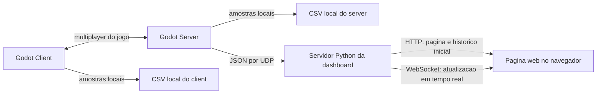

# 15 - Runtime de observabilidade e comandos de inicializacao do servidor

## Resumo

O servidor Godot ja aceita argumentos de aplicacao em runtime por meio de `OS.get_cmdline_user_args()`. Na pratica, isso permite exportar o projeto para Linux e controlar observabilidade no momento da execucao, sem criar builds diferentes para "servidor normal" e "servidor com metricas".

## Visao de arquitetura



Em alto nivel, o jogo roda entre client e server na camada de rede da Godot, enquanto a observabilidade fica ao lado: o servidor coleta periodicamente as metricas, pode persistir um historico local em CSV e tambem envia amostras em JSON para um processo Python separado. Esse processo Python nao participa da simulacao do jogo; ele apenas recebe as amostras, mantem uma janela curta em memoria e publica a dashboard para o navegador.

No estado atual, o client tambem possui coleta propria e pode salvar um CSV local com suas metricas. A diferenca e que a dashboard em tempo real esta alimentada pelo lado do servidor; o client nao envia suas amostras diretamente para a pagina web.

O contrato oficial passa a ser baseado em flags independentes:

- `--port=<porta>`
- `--record-metrics`
- `--stream-metrics`
- `--metrics-interval=<segundos>`
- `--metrics-stream-host=<host>`
- `--metrics-stream-port=<porta>`

As flags antigas `--network-metrics` e `--metrics` continuam existindo apenas para compatibilidade temporaria. Para uso novo, o padrao recomendado e `record` para persistencia em CSV e `stream` para envio em tempo real ao processo externo da dashboard.

## Como o build exportado recebe argumentos

Ao executar o servidor exportado no Linux, os argumentos da engine Godot ficam antes de `--` e os argumentos da aplicacao ficam depois de `--`.

Exemplo:

```bash
./Server.x86_64 --headless -- --port=7777 --record-metrics
```

Nesse comando:

- `--headless` e interpretado pela Godot.
- `--port=7777` e `--record-metrics` sao lidos pelo projeto via `OS.get_cmdline_user_args()`.

Sem o separador `--`, a aplicacao nao recebe essas flags. Por isso, o contrato de deploy e sempre:

```bash
./Server.x86_64 [flags da Godot] -- [flags do projeto]
```

## Comportamento esperado das flags

- Sem flags de observabilidade: o servidor sobe normalmente e nao grava CSV nem envia snapshots UDP.
- Com `--record-metrics`: o servidor grava historico em `user://network_metrics/` e nao depende da dashboard.
- Com `--stream-metrics`: o servidor envia snapshots JSON por UDP para um consumidor externo e nao precisa gravar em disco.
- Com `--record-metrics` e `--stream-metrics`: o servidor faz persistencia local e streaming ao mesmo tempo.
- `--metrics-interval=<segundos>` controla a janela de amostragem das duas modalidades.

Nao sera adotada sintaxe booleana do tipo `--save-metrics=true`. O padrao oficial e ativacao por presenca da flag, que combina melhor com CLIs reais e com a implementacao atual do projeto.

## Exemplos de execucao

Servidor normal, sem observabilidade:

```bash
./Server.x86_64 --headless -- --port=7777
```

Servidor com persistencia em CSV:

```bash
./Server.x86_64 --headless -- --port=7777 --record-metrics
```

Servidor com streaming para a dashboard:

```bash
./Server.x86_64 --headless -- --port=7777 --stream-metrics --metrics-stream-host=127.0.0.1 --metrics-stream-port=8765
```

Servidor com CSV e streaming:

```bash
./Server.x86_64 --headless -- --port=7777 --record-metrics --stream-metrics --metrics-interval=1.0 --metrics-stream-host=127.0.0.1 --metrics-stream-port=8765
```

Dashboard Python escutando o stream:

```bash
python metrics_dashboard/main.py --udp-host=127.0.0.1 --udp-port=8765 --http-host=127.0.0.1 --http-port=8000
```

Importante: a dashboard nao e ligada por uma flag da Godot. Ela sempre e um segundo processo, separado do servidor, que apenas consome o stream UDP configurado.

## Modelos de script para Linux

### `start_server.sh`

Script minimo para subir apenas o servidor e encaminhar flags extras do projeto:

```bash
#!/usr/bin/env bash
set -euo pipefail

SERVER_BIN="${SERVER_BIN:-./Server.x86_64}"
SERVER_PORT="${SERVER_PORT:-7777}"

exec "$SERVER_BIN" --headless -- --port="${SERVER_PORT}" "$@"
```

Exemplos de uso:

```bash
./start_server.sh
./start_server.sh --record-metrics
./start_server.sh --record-metrics --metrics-interval=0.5
```

### `start_server_with_dashboard.sh`

Script para subir a dashboard Python em paralelo e manter o servidor em primeiro plano:

```bash
#!/usr/bin/env bash
set -euo pipefail

SERVER_BIN="${SERVER_BIN:-./Server.x86_64}"
DASHBOARD_ENTRY="${DASHBOARD_ENTRY:-./metrics_dashboard/main.py}"
PYTHON_BIN="${PYTHON_BIN:-python3}"
SERVER_PORT="${SERVER_PORT:-7777}"
UDP_HOST="${UDP_HOST:-127.0.0.1}"
UDP_PORT="${UDP_PORT:-8765}"
HTTP_HOST="${HTTP_HOST:-127.0.0.1}"
HTTP_PORT="${HTTP_PORT:-8000}"
METRICS_INTERVAL="${METRICS_INTERVAL:-1.0}"

"$PYTHON_BIN" "$DASHBOARD_ENTRY" \
  --udp-host="${UDP_HOST}" \
  --udp-port="${UDP_PORT}" \
  --http-host="${HTTP_HOST}" \
  --http-port="${HTTP_PORT}" &

dashboard_pid=$!

cleanup() {
  kill "$dashboard_pid" 2>/dev/null || true
}

trap cleanup EXIT

"$SERVER_BIN" --headless -- \
  --port="${SERVER_PORT}" \
  --stream-metrics \
  --metrics-interval="${METRICS_INTERVAL}" \
  --metrics-stream-host="${UDP_HOST}" \
  --metrics-stream-port="${UDP_PORT}" \
  "$@"
```

Exemplos de uso:

```bash
./start_server_with_dashboard.sh
./start_server_with_dashboard.sh --record-metrics
```

No segundo exemplo, o script continua iniciando a dashboard, mas tambem pede persistencia local em CSV para o servidor.

## Manual - servidor exportado

### NAME

`server-headless` - executa o servidor exportado do jogo com flags opcionais de observabilidade.

### SYNOPSIS

```text
./Server.x86_64 --headless -- --port=<porta> [--record-metrics] [--stream-metrics]
    [--metrics-interval=<segundos>]
    [--metrics-stream-host=<host>]
    [--metrics-stream-port=<porta>]
```

### DESCRIPTION

Inicializa o servidor autoritativo em modo headless. A porta de rede e configurada pela flag `--port`. A observabilidade pode ser ativada de forma independente para persistencia em CSV (`--record-metrics`) e para envio em tempo real a um coletor externo (`--stream-metrics`).

### OPTIONS

- `--port=<porta>`: define a porta UDP do servidor do jogo.
- `--record-metrics`: habilita gravacao de metricas em CSV dentro de `user://network_metrics/`.
- `--stream-metrics`: habilita envio de snapshots JSON por UDP.
- `--metrics-interval=<segundos>`: define o intervalo de amostragem das metricas.
- `--metrics-stream-host=<host>`: define o host de destino do stream UDP.
- `--metrics-stream-port=<porta>`: define a porta de destino do stream UDP.

### EXAMPLES

```bash
./Server.x86_64 --headless -- --port=7777
./Server.x86_64 --headless -- --port=7777 --record-metrics
./Server.x86_64 --headless -- --port=7777 --stream-metrics --metrics-stream-host=127.0.0.1 --metrics-stream-port=8765
./Server.x86_64 --headless -- --port=7777 --record-metrics --stream-metrics --metrics-interval=1.0 --metrics-stream-host=127.0.0.1 --metrics-stream-port=8765
```

### FILES

- `user://network_metrics/`: destino logico dos CSVs gerados pelo servidor.
- `~/.local/share/godot/app_userdata/Server/network_metrics/`: caminho tipico no Linux quando o nome do projeto exportado continua `Server`.

### NOTES

- As flags do projeto precisam vir depois de `--`.
- `--record-metrics` e `--stream-metrics` sao independentes.
- `--network-metrics` e `--metrics` ainda podem funcionar por compatibilidade, mas nao devem ser usados como contrato novo.
- O servidor nao inicia a dashboard sozinho.

## Manual - script servidor + dashboard

### NAME

`start_server_with_dashboard.sh` - inicia a dashboard Python e sobe o servidor Godot com streaming de metricas configurado.

### SYNOPSIS

```text
./start_server_with_dashboard.sh [--record-metrics]
```

### DESCRIPTION

Inicializa primeiro o processo Python da dashboard e, em seguida, executa o servidor Godot em foreground com `--stream-metrics`. O uso de `--record-metrics` e opcional e apenas acrescenta persistencia em CSV no lado do servidor.

### OPTIONS

- `--record-metrics`: repassa a flag para o servidor exportado.
- `SERVER_PORT`: sobrescreve a porta de rede do jogo.
- `UDP_HOST` e `UDP_PORT`: configuram o destino do stream e o listener da dashboard.
- `HTTP_HOST` e `HTTP_PORT`: configuram o endereco HTTP da dashboard.
- `METRICS_INTERVAL`: define o intervalo de amostragem.
- `SERVER_BIN`, `PYTHON_BIN` e `DASHBOARD_ENTRY`: permitem apontar para caminhos diferentes sem editar o script.

### EXAMPLES

```bash
./start_server_with_dashboard.sh
./start_server_with_dashboard.sh --record-metrics
HTTP_PORT=8080 UDP_PORT=9000 ./start_server_with_dashboard.sh
```

### FILES

- `metrics_dashboard/main.py`: entrypoint do processo Python da dashboard.
- `metrics_dashboard/requirements.txt`: dependencias da dashboard.

### NOTES

- A dashboard e opcional e externa ao processo Godot.
- O script deve iniciar a dashboard antes do servidor para evitar perder as primeiras amostras.
- Se o objetivo for apenas persistir CSV, use `start_server.sh --record-metrics` e nao inicie a dashboard.

## Validacao recomendada

- Confirmar que o servidor exportado continua lendo argumentos apenas depois de `--`.
- Confirmar que, sem flags, nao ha CSV nem stream UDP.
- Confirmar que `--record-metrics` gera CSV em `user://network_metrics/`.
- Confirmar que `--stream-metrics` envia snapshots para o processo Python sem exigir gravacao em disco.
- Confirmar que `--record-metrics` e `--stream-metrics` funcionam juntos.
- Confirmar que os scripts usados no deploy refletem exatamente o contrato acima.
