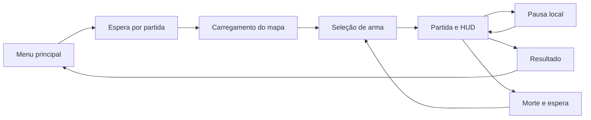
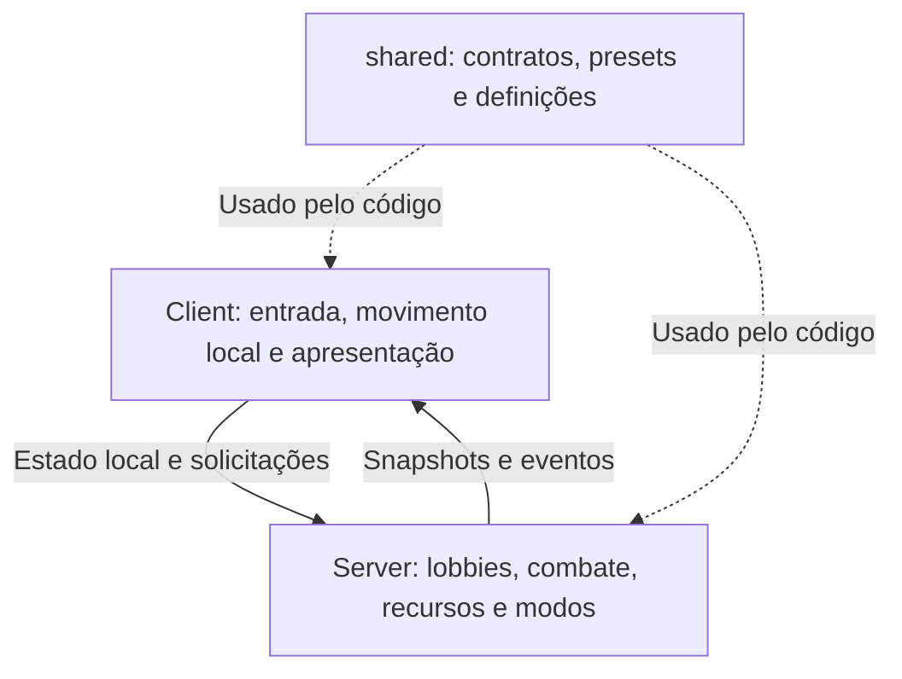
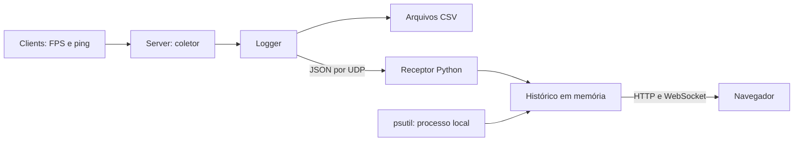

# Desenvolvimento de um jogo 3D multijogador de tiro em primeira pessoa

>  As notas **Evidência pendente** identificam resultados experimentais ou figuras que ainda precisam ser produzidos. Nenhuma medição foi criada para preencher essas lacunas.

## 1 Introdução

Neste capítulo são apresentados o contexto do trabalho, o problema abordado e os objetivos do desenvolvimento. Também é delimitado o conjunto de funcionalidades da versão descrita no relatório, considerando as diferenças entre a proposta inicial e o sistema implementado.

### 1.1 Contextualização

O desenvolvimento de um jogo envolve a integração entre sua programação e os elementos com os quais o jogador interage. No presente trabalho, essa integração compreendeu o controle de um personagem, a construção de um cenário tridimensional, a apresentação de informações na interface e o processamento de uma partida compartilhada pela rede. A motivação registrada no TCC1 foi utilizar a criação de um jogo como oportunidade de aprendizado sobre essas diferentes atividades, tendo como proposta um jogo de tiro em primeira pessoa com elementos de plataforma. [TCC1]

Para a implementação foi utilizado o motor de jogos Godot. Sua organização em nós e cenas permite representar tanto elementos do mundo, como personagens e armas, quanto telas e componentes de interface. Cenas podem ser reutilizadas e combinadas para formar sistemas maiores, enquanto sinais permitem comunicar a ocorrência de eventos entre os elementos. Essa organização oferece uma base para reunir, em um mesmo projeto, as diferentes partes necessárias à execução de um jogo. [GODOT-CONCEITOS]

A participação de vários jogadores exige manter informações coerentes entre computadores distintos, apesar dos atrasos de comunicação. No jogo desenvolvido, estados como posição, coleta de itens e pontuação foram tratados por um servidor dedicado, com mensagens de eventos e distribuição periódica de estados da partida. [FIEDLER-REDE] [CLIENT-LOBBY] [SERVER-LOBBY]

### 1.2 Problema e motivação

O problema deste trabalho consistiu em desenvolver e integrar as funcionalidades de um jogo de tiro em primeira pessoa 3D, competitivo e executado em rede. A implementação deveria permitir que os participantes se movimentassem por uma arena, utilizassem armas, coletassem recursos e disputassem objetivos em equipes. Além das regras de combate, seria necessário organizar a entrada dos jogadores, o início e o encerramento das partidas e a apresentação de seus resultados. Esses requisitos derivaram do documento de projeto elaborado no TCC1. [TCC1]

Uma das principais questões técnicas foi definir qual parte do sistema seria responsável por cada informação. O personagem controlado pelo jogador precisava responder à entrada local, enquanto resultados como dano, consumo de munição e pontuação deveriam ser mantidos no servidor. Essa divisão também exigiu decidir quais estados seriam enviados continuamente, quais poderiam ser comunicados apenas quando mudassem e quais detalhes visuais poderiam permanecer locais. A solução adotada é descrita na seção 5.2. [JOGADOR-LOCAL] [SERVER-LOBBY] [CLIENT-LOBBY]

### 1.3 Objetivos

#### 1.3.1 Objetivo geral

O objetivo geral do trabalho foi desenvolver um jogo 3D multijogador competitivo do gênero tiro em primeira pessoa, com combate em arena e elementos de plataforma. Na versão implementada, a comunicação foi organizada em uma arquitetura cliente-servidor com servidor dedicado, responsável pelas regras de combate, recursos e resultado das partidas. Esse objetivo retoma a proposta de aprendizado por desenvolvimento do TCC1, incorporando a arquitetura efetivamente construída. [TCC1] [SERVER-LOBBY]

#### 1.3.2 Objetivos específicos

A partir desse objetivo, foram considerados os seguintes objetivos específicos, relacionados à proposta original e às funcionalidades documentadas no projeto. [TCC1] [DOC-JOGADOR] [DOC-COMBATE] [DOC-MAPA] [DOC-METRICAS]

- Implementar movimentação em primeira pessoa, corrida, salto duplo e interação com plataformas de impulso.
- Desenvolver armas, granadas, vida, morte, retorno à partida e coleta de recursos.
- Implementar modos de jogo competitivos em equipes, com acompanhamento de pontuação e encerramento da partida.
- Organizar a comunicação entre Client e Server e compartilhar contratos e definições usados pelos dois projetos.
- Construir uma arena e integrar os modelos, materiais, efeitos sonoros e componentes de interface necessários à experiência de jogo.
- Preparar configurações de exportação para os executáveis de Client e Server.
- Implementar coleta de métricas e uma dashboard para acompanhar a execução e apoiar a avaliação técnica.

### 1.4 Escopo do trabalho

A versão descrita possui dois times, identificados pelas cores azul e vermelho, e dois modos selecionáveis: Team Deathmatch e King of the Hill. Ambos utilizam o mapa Highrise e presets com limite de 300 segundos, meta de 20 pontos e dois jogadores por partida. O processo servidor permite criar até quatro lobbies. Esses valores representam limites de configuração encontrados no código, e não uma capacidade de desempenho comprovada por ensaios de carga. [PRESETS] [SERVER]

O conjunto de armas é composto por pistola, submetralhadora e espingarda, além de granadas. Também foram implementados pickups de vida e munição e efeitos temporários de dano e cadência de tiro. Capture the Flag, canhão laser, lança-foguetes e vidas limitadas fizeram parte da proposta ou do planejamento, mas não compõem o funcionamento descrito nesta versão. O mapa Prototype permaneceu registrado para desenvolvimento, sem integrar os presets apresentados no menu principal. [ARMAS] [PICKUPS] [PRESETS] [TCC1] [DOC-MAPA]

O trabalho contempla configurações de exportação do Client para Windows e Linux e do Server para Linux. A avaliação apresentada neste texto distingue a existência dessas configurações, a implementação das funcionalidades e a comprovação experimental da versão distribuída. A geração de uma build a partir de um ambiente limpo e a execução dos cenários de avaliação ainda precisam ter suas evidências incorporadas ao relatório. [EXPORT-CLIENT] [EXPORT-SERVER] [GUIA-BUILD] [GUIA-RELEASE]

### 1.5 Estrutura do relatório

O Capítulo 2 apresenta os conceitos utilizados no trabalho. O Capítulo 3 relaciona os jogos de referência às decisões adotadas. O Capítulo 4 descreve as ferramentas, a organização do desenvolvimento e os procedimentos de avaliação. O Capítulo 5 apresenta o sistema por funcionalidades, incluindo sua arquitetura de rede e os mecanismos de observação. Por fim, o Capítulo 6 discute os objetivos alcançados, as contribuições e as possibilidades de continuidade.

## 2 Fundamentação teórica

Este capítulo apresenta os conceitos necessários para compreender a implementação. A discussão se concentra nas características do jogo, na comunicação entre seus participantes e nos mecanismos utilizados para observar sua execução.

### 2.1 Motores de jogos e Godot Engine

Neste trabalho, o motor de jogos corresponde ao ambiente que reúne os recursos utilizados para construir e executar a aplicação. Na Godot, nós representam unidades de comportamento e podem ser organizados em cenas reutilizáveis. Uma cena de personagem, por exemplo, pode combinar corpo físico, câmera e apresentação visual. Essa composição também se aplica a menus e ao próprio mapa. A documentação da Godot apresenta nós, cenas, árvore de cenas e sinais como conceitos centrais de sua organização. [GODOT-CONCEITOS]

A implementação consultada utiliza GDScript para definir comportamentos e recursos próprios do motor para física tridimensional, entrada, interface, áudio e comunicação em rede. A mesma base tecnológica é empregada nos dois projetos Godot, embora o Client e o Server possuam responsabilidades diferentes. O primeiro concentra a interação e a apresentação; o segundo mantém as regras e os dados compartilhados da partida. [PROJETO-CLIENT] [PROJETO-SERVER] [DOC-ARQUITETURA]

### 2.2 Jogos de tiro em primeira pessoa e arena shooters

Nos jogos de tiro em primeira pessoa, a exploração e o combate são apresentados a partir do ponto de vista do personagem controlado. Hullett e Whitehead descrevem esse tipo de jogo como uma navegação por um mundo tridimensional em que o jogador enfrenta outros personagens utilizando armas. Essa perspectiva relaciona o enquadramento da câmera à direção de observação e de ataque. [HULLETT]

O recorte adotado neste trabalho foi o de combate em arena, presente nas referências Quake III Arena e Unreal Tournament. Nesses exemplos, o confronto se organiza em espaços próprios para partidas, com diferentes armas e regras de disputa. A proposta do TCC aproveitou a combinação entre movimentação, combate e recursos distribuídos pelo cenário, sem incluir uma campanha narrativa ou progressão por níveis de personagem. [QUAKE] [UNREAL] [TCC1]

### 2.3 Elementos de jogos de plataforma em ambientes 3D

Os elementos de plataforma considerados no projeto são ações e estruturas que permitem vencer diferenças de altura e alcançar outras regiões do cenário. A proposta inicial incluiu salto duplo, plataformas suspensas e plataformas de impulso. A versão implementada preservou o salto duplo e os jump pads, relacionando o deslocamento vertical ao percurso pela arena. [TCC1] [JOGADOR-LOCAL] [JUMP-PAD]

Lovely Planet oferece uma referência para a combinação entre saltar, mirar e disparar. A descrição do próprio desenvolvedor enfatiza a alternância entre desviar de projéteis e buscar uma posição de tiro. No presente trabalho, essa referência ajuda a contextualizar a intenção de reunir combate e movimentação, enquanto as regras concretas de salto e impulso são próprias da implementação. [LOVELY] [TCC1] [JOGADOR-LOCAL]

### 2.4 Jogos multijogador competitivos em tempo real

O TCC1 organizou os jogos multijogador segundo a disposição dos participantes, sua forma de interação, os papéis desempenhados e o momento das ações. Dentro dessa classificação, o sistema desenvolvido pode ser descrito como um jogo em rede, competitivo, simétrico e de tempo real: os participantes executam instâncias em computadores conectados, disputam objetivos, utilizam o mesmo conjunto de ações e atuam durante a mesma partida. A simetria se refere às regras disponíveis aos jogadores, não a uma comprovação de equilíbrio entre as regiões do mapa. [TCC1] [PRESETS] [JOGADOR-LOCAL] [ARMAS]

A participação em tempo real não implica ausência de atraso. Cada computador possui seu próprio ciclo de execução, e as informações levam tempo para atravessar a rede. Por isso, a aplicação precisa conciliar a resposta percebida pelo jogador com o estado conhecido pelos demais participantes. Predição e interpolação são estratégias distintas para lidar com esse problema: a primeira antecipa localmente uma resposta; a segunda constrói uma transição entre estados recebidos. [FIEDLER-REDE] [FIEDLER-INTERPOLACAO]

### 2.5 Arquiteturas de comunicação para jogos

A arquitetura define como os participantes trocam informações e onde são decididos os resultados. Fiedler apresenta tanto a troca de comandos entre pares quanto a organização cliente-servidor. Nesta última, o servidor mantém uma referência comum para os clientes; no modelo de simulação determinística entre pares, a reprodução consistente dos comandos depende de condições iniciais e regras equivalentes. Esses modelos exigem soluções diferentes para sincronização. [FIEDLER-REDE]

No presente projeto, o servidor foi implementado como um processo separado dos jogadores. A autoridade, porém, deve ser descrita por responsabilidade: o Server calcula dano e pontuação, mas utiliza posições recebidas dos Clients para atualizar os personagens. A existência de um servidor dedicado, portanto, não significa que toda a movimentação seja recalculada e validada por ele. Essa delimitação é necessária para interpretar tanto a arquitetura quanto suas limitações. [SERVER] [SERVER-LOBBY]

### 2.6 Tecnologias de rede utilizadas

O UDP é um protocolo de transporte baseado em datagramas. Sua especificação não garante entrega nem proteção contra duplicação de mensagens; requisitos adicionais devem ser tratados por outras camadas. No trabalho, ele aparece em dois contextos: como base da comunicação multijogador por ENet e como transporte direto das amostras enviadas à dashboard. A escolha do transporte, por si só, não determina se uma mensagem da aplicação será reenviada. [UDP] [GODOT-REDE] [LOGGER] [RECEPTOR]

A Godot disponibiliza comunicação de alto nível por chamadas remotas de procedimento, ou RPCs. Uma função pode ser executada em outro participante, com restrições sobre quem pode chamá-la e sobre a forma de transferência. Essa API permite usar a estrutura de nós do jogo para organizar a comunicação; o projeto a utiliza nos componentes que representam o servidor e cada lobby. [GODOT-REDE] [SERVER] [CLIENT-LOBBY]

Os modos de transferência usados são confiável, não confiável e não confiável ordenado. No primeiro, há confirmação e tentativas de reenvio; no segundo, uma mensagem pode se perder ou chegar fora de ordem; no terceiro, mensagens atrasadas podem ser descartadas quando uma atualização posterior já foi recebida. Essa diferença fundamenta o uso de eventos confiáveis para mudanças discretas e de atualizações substituíveis para movimento. [GODOT-PEER]

Outra técnica utilizada foi a interpolação de snapshots. Um snapshot é um registro do estado em determinado instante. Ao manter um pequeno histórico dos registros recebidos, o Client pode apresentar uma posição intermediária entre dois deles, em vez de saltar diretamente para cada atualização. O buffer acrescenta um atraso de apresentação, em troca de uma transição visual mais contínua. [FIEDLER-INTERPOLACAO]

### 2.7 Observabilidade em jogos em rede

A observabilidade utiliza informações produzidas por um sistema para ajudar a compreender seu comportamento. A documentação do OpenTelemetry apresenta métricas como medições que descrevem aspectos de sua operação. No contexto deste jogo, elas permitem acompanhar condições como quantidade de participantes, tráfego de rede e tempo de execução de uma parte do servidor. O projeto possui instrumentação própria; não utiliza uma integração com o OpenTelemetry. [OBSERVABILIDADE] [COLETOR]

É necessário distinguir observar a execução de demonstrar seu desempenho. Uma dashboard pode mostrar uma alteração de latência durante uma partida, mas a comparação entre condições depende de registrar o cenário, o intervalo e a origem das amostras. O trabalho dispõe de gravação em CSV e apresentação em tempo real para apoiar esses dois usos, enquanto o plano de fechamento mantém a realização do experimento como uma atividade própria. [DOC-METRICAS] [LOGGER] [PLANO-FECHAMENTO]

### 2.8 Level design para arenas competitivas

O level design compreende a organização do espaço em que as ações do jogo ocorrem. Hullett e Whitehead relacionam geometria e posicionamento de itens às situações criadas durante a exploração e o combate. Embora sua análise se concentre em níveis de FPS para um jogador, ela oferece uma base para discutir altura, circulação e distribuição de recursos. Sua aplicação a Highrise é uma interpretação de projeto, e não uma evidência de balanceamento competitivo. [HULLETT]

Na arena desenvolvida, pontos de nascimento, itens, plataformas e zona de controle ocupam posições específicas. O percurso entre esses elementos faz parte das decisões disponíveis ao jogador: permanecer no objetivo, procurar munição ou recuperar vida. A presença de regiões em alturas diferentes também associa o combate às ações de salto e impulso. A análise detalhada dessa disposição é apresentada na seção 5.5. [MAPA-CLIENT] [MAPA-SERVER] [JOGADOR-LOCAL]

## 3 Jogos similares e referências

Neste capítulo são retomados os jogos utilizados como referência na proposta. A comparação se concentra nos aspectos que ajudam a explicar o produto desenvolvido, considerando combate, modos de disputa, movimentação e direção visual.

### 3.1 Critérios de comparação

O TCC1 destacou Doom, Quake III Arena, Unreal Tournament e Lovely Planet. Para este relatório, essas referências foram organizadas pelo papel que desempenham na proposta: contextualização do gênero, combate em arena, variedade de objetivos e combinação entre tiro, salto e apresentação cartunesca. A comparação não pretende medir a qualidade do projeto em relação a produtos comerciais, mas identificar quais características orientaram sua concepção. [TCC1]

### 3.2 Referências clássicas de FPS e arena shooter

Doom foi utilizado no TCC1 para introduzir a discussão sobre jogos de tiro em primeira pessoa e confrontos multijogador. O código disponibilizado pela id Software também constitui uma referência primária de implementação acessível para estudo. Neste relatório, sua presença cumpre uma função de contextualização; não há evidência de que o código do jogo tenha sido incorporado ao projeto desenvolvido. [TCC1] [DOOM]

Quake III Arena apresenta um combate centrado em arenas, diferentes armas e power-ups. A descrição publicada na loja oficial do produto inclui modos como Team Deathmatch e Capture the Flag. Para o presente trabalho, os aspectos relevantes são a continuidade do confronto e a disponibilidade de recursos que alteram as condições de combate. A implementação aproveitou essas ideias em um conjunto menor de armas e em partidas configuradas para dois jogadores. [QUAKE] [ARMAS] [PRESETS]

Unreal Tournament reúne modos de confronto com objetivos distintos, como Deathmatch, Domination e Capture the Flag. A proposta inicial também relacionou seu mapa Facing Worlds a um protótipo com regiões opostas. Na versão atual, Highrise passou a ser o mapa selecionável e o controle de área foi implementado por King of the Hill. A comparação relevante está na possibilidade de reutilizar movimentação e combate sob regras de pontuação diferentes. [UNREAL] [TCC1] [PRESETS] [TDM] [KOTH]

### 3.3 Referências visuais e de jogabilidade

Lovely Planet foi escolhido no TCC1 como referência de estilo cartunesco, com cores marcantes e formas simplificadas. A apresentação do desenvolvedor também relaciona sua jogabilidade a saltar e disparar. O trabalho retomou essa combinação na concepção de um FPS com elementos de plataforma, embora o resultado se concentre em confrontos entre equipes, e não na progressão por fases descrita para Lovely Planet. [TCC1] [LOVELY] [PRESETS]

A intenção visual registrada na proposta foi produzir personagens e cenários sem exigir uma representação realista. Na implementação, os personagens possuem materiais associados ao time, variações locais de cor e anéis com materiais próprios. Esses elementos se somam aos indicadores da interface para representar o pertencimento à equipe. A escolha estética é documentada pela proposta e pelos recursos do projeto; sua eficácia para diferentes públicos ainda demanda avaliação específica. [TCC1] [JOGADOR-REMOTO] [JOGADOR-LOCAL]

### 3.4 Comparação com o jogo desenvolvido

A Tabela 1 relaciona os aspectos selecionados das referências ao sistema implementado. As correspondências indicam aproximações de conceito; não implicam reprodução dos mapas, regras completas ou conteúdo audiovisual dos jogos citados. [TCC1] [PRESETS] [ARMAS] [MAPA-SERVER]

**Tabela 1 — Relação entre referências e decisões do projeto.**

| Referência | Aspecto considerado | Relação com o projeto |
| --- | --- | --- |
| Doom | Contextualização do FPS e do combate multijogador. | Perspectiva em primeira pessoa e confronto entre participantes. |
| Quake III Arena | Combate em arena, armas e power-ups. | Três armas, recursos coletáveis e efeitos temporários. |
| Unreal Tournament | Diferentes regras de disputa sobre uma base de combate. | TDM e KOTH compartilham jogador, armas e mapa. |
| Lovely Planet | Combinação entre salto, tiro e proposta visual simplificada. | Salto duplo, plataformas de impulso e direção visual cartunesca. |

Fonte: elaboração a partir do TCC1, das descrições dos produtos e da implementação. [TCC1] [QUAKE] [UNREAL] [LOVELY] [JOGADOR-LOCAL]

## 4 Materiais e métodos

Este capítulo descreve as ferramentas utilizadas e a organização técnica do trabalho. Também apresenta o procedimento de verificação e o método de coleta previsto para a avaliação. A existência de um roteiro de testes é distinguida de sua execução documentada, para que atividades planejadas não sejam apresentadas como resultados concluídos.

### 4.1 Ferramentas e tecnologias

A Godot 4.5 foi utilizada nos projetos Client e Server, com comportamentos programados em GDScript. O Blender integrou a proposta de modelagem e texturização, e o repositório utiliza Git para controle de versão. Scripts PowerShell dão suporte à preparação dos diretórios compartilhados e à sincronização do mapa. Para a dashboard foram utilizados Python e FastAPI, com recepção UDP, comunicação WebSocket e consulta de dados do processo por psutil. A Tabela 2 resume o papel desses materiais. [TCC1] [PROJETO-CLIENT] [PROJETO-SERVER] [SETUP-SHARED] [GERADOR-MAPA] [DASHBOARD] [PROCESSO]

**Tabela 2 — Ferramentas e responsabilidades.**

| Material | Utilização no trabalho |
| --- | --- |
| Godot e GDScript | Cenas, física, regras, interface, áudio e comunicação do jogo. |
| Blender | Autoria de modelos e recursos visuais prevista e mantida no fluxo de assets. |
| Git | Organização e versionamento do projeto. |
| PowerShell | Preparação dos links compartilhados e geração de cenas do mapa de servidor. |
| Python e FastAPI | Recepção e disponibilização das amostras na dashboard. |
| psutil | Consulta de CPU e memória do processo identificado pelo PID. |

Fonte: proposta, guias de manutenção e arquivos de suporte do projeto. [TCC1] [GUIA-ASSETS] [SETUP-SHARED] [GERADOR-MAPA] [DASHBOARD] [PROCESSO]

### 4.2 Processo de desenvolvimento

A proposta do TCC1 indicou o modelo Double Diamond como referência de processo. O Design Council o apresenta por meio de atividades de descoberta, definição, desenvolvimento e entrega. No material disponível, há uma proposta inicial, diferentes funcionalidades implementadas e planos de fechamento posteriores; esses registros permitem acompanhar mudanças de escopo, mas não comprovam a execução formal de todas as etapas do modelo em cada iteração. Assim, o Double Diamond é apresentado como referência do planejamento original. [TCC1] [DOUBLE-DIAMOND] [PLANO-FECHAMENTO]

Para descrever o desenvolvimento realizado, o relatório organiza o produto pelas funcionalidades que podem ser identificadas no repositório. Jogador, combate, modos, interface e observabilidade são tratados a partir de seus comportamentos e das relações entre seus componentes. Essa organização acompanha a documentação técnica consolidada por feature e permite explicar as decisões sem depender de uma cronologia de commits ou de tarefas ainda não encerradas. [DOC-JOGADOR] [DOC-COMBATE] [DOC-MODOS] [DOC-HUD] [DOC-METRICAS]

### 4.3 Evolução da proposta do TCC1

A proposta original previa um participante hospedeiro e utilizava a denominação peer-to-peer para sua arquitetura. A implementação passou a separar o programa executado pelos jogadores do processo que mantém as partidas. Também passou a utilizar RPCs e snapshots próprios para a sincronização, em vez de depender do mecanismo de replicação automática descrito no protótipo inicial. Essa mudança tornou explícitas as responsabilidades de cada lado da comunicação. [TCC1] [SERVER] [CLIENT-LOBBY] [SERVER-LOBBY]

O recorte de conteúdo também mudou. A proposta já mencionava Rei do Pedaço, além de mata-mata e Capture the Flag; na implementação, foram disponibilizados TDM e KOTH, enquanto CTF ficou fora do escopo. Pistola, SMG e shotgun formam o catálogo atual, e a melhoria temporária de velocidade de movimentação deu lugar a uma melhoria de cadência de tiro. Essas diferenças são apresentadas na seção 5.13.3. Os arquivos demonstram o que mudou, mas não justificam atribuir a cada alteração um motivo que não tenha sido registrado. [TCC1] [PRESETS] [ARMAS] [BUFF-DANO] [BUFF-CADENCIA]

### 4.4 Organização do projeto

O código do jogo foi organizado em dois projetos Godot, cada um com sua configuração e suas cenas de entrada. O Client contém o controle local, a apresentação do mapa e as telas. O Server mantém conexões, lobbies, jogadores, recursos e modos de jogo. Um terceiro diretório, denominado `shared`, reúne definições interpretadas pelos dois lados, como identificadores, contratos de mensagens, configurações de partida e inventário de munição. [DOC-ARQUITETURA] [DOC-SHARED]

O compartilhamento local é preparado por um script que cria links de diretório para a mesma origem. Portanto, o conteúdo acessado por cada projeto não corresponde a duas cópias independentes do código comum. Já os arquivos de autoria dos assets seguem o padrão existente de pastas `import/`. Esse arranjo faz parte da preparação do ambiente e precisa ser considerado ao reproduzir uma build em outra máquina. [SETUP-SHARED] [DOC-SHARED] [GUIA-ASSETS]

### 4.5 Método de verificação funcional

O procedimento documentado para uma verificação funcional consiste em executar o Server e conectar dois Clients, percorrendo o fluxo completo de partida. O roteiro inclui entrada no lobby, escolha de modo, nascimento dos personagens, combate, coleta de recursos, atualização da interface, encerramento e retorno ao menu. Para KOTH, é necessário observar separadamente a zona vazia, controlada e contestada, pois cada estado produz uma consequência diferente sobre a pontuação. [GUIA-RELEASE] [GUIA-LOCAL] [COLINA] [KOTH]

A execução desse procedimento deve registrar a versão utilizada, a plataforma e a evidência de cada resultado. Uma função presente no código confirma a existência de uma implementação, mas não demonstra, isoladamente, que ela foi exercitada com sucesso em uma build exportada. Neste relatório, a inspeção do código sustenta a descrição funcional, enquanto a tabela de resultados mantém explícita a necessidade de anexar o registro da execução. [GUIA-RELEASE]

> **Evidência pendente:** registro do teste integrado da versão escolhida para a entrega, com data, identificação da build, participantes ou instâncias utilizadas e resultado de cada cenário. O procedimento acima está definido; sua aprovação não foi presumida.

### 4.6 Método de coleta e análise de métricas

A implementação permite coletar amostras periódicas, com intervalo padrão de um segundo, e gravá-las em CSV ou transmiti-las à dashboard. O coletor utiliza contadores do host ENet, estatísticas dos peers e informações de lobbies e jogadores. Os Clients também informam seus FPS, que são reunidos pelo Server. Essa infraestrutura fornece as variáveis para o experimento, mas a quantidade de amostras e a duração efetiva de cada rodada precisam ser registradas durante sua execução. [COLETOR] [LOGGER] [FPS-CLIENT]

Para a avaliação desta versão, propõe-se comparar o servidor sem partidas ativas com uma partida de dois jogadores em TDM e uma de dois jogadores em KOTH. Cada rodada deve usar a mesma build, intervalo de coleta e ambiente, registrando o período de espera e o de jogo ativo. Experimentos com mais lobbies podem ampliar essa comparação até o limite configurado, desde que sejam identificados separadamente. Trata-se do protocolo proposto para completar a avaliação, compatível com os presets atuais e com a finalidade do experimento previsto no plano de fechamento. [PRESETS] [SERVER] [PLANO-FECHAMENTO]

A análise deverá relacionar tráfego, RTT, perda estimada de pacotes e tempo medido do processamento dos lobbies ao número de participantes e ao estado da partida. Para evitar comparar medidas diferentes, devem ser preservados os nomes, as unidades e os timestamps do contrato. A medição de CPU e memória requer um registro adicional: esses valores são consultados pela dashboard no sistema operacional e não integram automaticamente os CSVs produzidos pelo logger do Godot. [COLETOR] [CONTRATO-METRICAS] [LOGGER] [PROCESSO] [ARMAZENAMENTO]

> **Evidência pendente:** ambiente de execução, duração e repetições das rodadas, arquivos de dados brutos e resultados calculados. Não foram atribuídos valores a latência, CPU, memória ou capacidade do servidor sem essas medições.

## 5 Desenvolvimento e resultados

Este capítulo apresenta as funcionalidades implementadas e a forma como foram integradas. Primeiro são descritos o ciclo do jogo e sua arquitetura; em seguida, jogador, modos, mapa, combate e interface. A coleta de métricas e a dashboard são apresentadas como funcionalidades técnicas. A discussão dos resultados diferencia o comportamento identificado na implementação das evidências de execução ainda necessárias.

### 5.1 Visão geral do jogo

#### 5.1.1 Conceito e ciclo principal de jogabilidade

O jogo desenvolvido organiza confrontos entre duas equipes em uma arena tridimensional. O participante informa seu nome, seleciona um preset e aguarda a formação da partida. Após o carregamento do mapa e a escolha de arma, passa a controlar seu personagem, podendo buscar recursos, enfrentar o adversário e disputar o objetivo do modo. A partida termina conforme suas regras, e uma tela apresenta os resultados por equipe e por jogador. [PRESETS] [SERVER] [SERVER-LOBBY] [MENU] [RESULTADO]

O ciclo de interação combina deslocamento, gerenciamento de munição e confronto. Ao perder todos os pontos de vida, o personagem é removido e, caso a partida continue, o jogador recebe uma nova oportunidade de escolher sua arma e retornar ao mapa. Dessa forma, a participação se organiza em torno da disputa em andamento. O inventário é preparado novamente no nascimento, sem representar uma progressão persistente entre partidas. [SERVER-LOBBY] [INVENTARIO]

#### 5.1.2 Controles e movimentação

A movimentação foi implementada no Client por meio de um corpo tridimensional controlado por script. A direção é calculada a partir da entrada e da orientação do personagem. A câmera permite olhar horizontal e verticalmente, com limitação da rotação vertical. O jogador pode correr e realizar até dois saltos antes de retornar ao chão. A implementação também considera a entrada por controle, incluindo deslocamento e mira pelos analógicos. [JOGADOR-LOCAL] [PROJETO-CLIENT]

O salto duplo é controlado por uma contagem de saltos utilizados. Quando o personagem aterrissa, essa contagem é reiniciada; ao tocar uma plataforma de impulso, a velocidade vertical é alterada e os saltos também são restabelecidos. Os jump pads são configurados pelo Server e apresentados no Client, onde a detecção de contato aplica o impulso ao personagem local. O Server recebe depois a posição resultante pelo fluxo normal de movimento; não há uma validação separada de cada impulso na implementação consultada. [JOGADOR-LOCAL] [JUMP-PAD] [SERVER-LOBBY]

**Tabela 3 — Principais controles presentes na configuração do Client.**

| Ação | Teclado e mouse | Controle, em nomenclatura equivalente à disposição Xbox |
| --- | --- | --- |
| Movimentar | W, A, S e D | Analógico esquerdo |
| Mirar | Movimento do mouse | Analógico direito |
| Correr | Shift | Pressionar o analógico esquerdo |
| Saltar | Espaço | A |
| Disparar | Botão esquerdo do mouse | Gatilho direito ou botão superior direito |
| Lançar granada | Q | Botão superior esquerdo ou B |
| Selecionar arma | 1, 2 e 3 | Direcional esquerdo/direito para alternar |
| Abrir ou fechar pausa | Esc | Start/Menu |

Fonte: Input Map e tratamento de entrada do Client. O mapeamento documenta a configuração existente; a verificação em dispositivos físicos integra o teste da release. [PROJETO-CLIENT] [JOGADOR-LOCAL] [GUIA-RELEASE]

#### 5.1.3 Fluxo de telas

O gerenciador de cenas abre o menu principal quando o Client inicia. A formação da partida conduz ao carregamento do mapa e à seleção de arma; durante o jogo, a pausa disponibiliza uma tela local e libera o cursor. Esse estado interrompe o controle daquele jogador, mas não suspende o processo servidor. Ao final da partida, os dados recebidos são entregues à tela de resultado, que permite voltar ao menu. A Figura 1 resume esse encadeamento. [CENAS-CLIENT] [JOGADOR-LOCAL] [CLIENT-LOBBY] [RESULTADO]

Figura 1 — Fluxo principal de telas e participação. Fonte: elaboração a partir dos gerenciadores de cena e lobby. O retorno após a morte depende de a partida continuar ativa. [CENAS-CLIENT] [CLIENT-LOBBY] [SERVER-LOBBY]

### 5.2 Arquitetura do sistema

#### 5.2.1 Separação entre Client, Server e shared

O sistema foi dividido para que apresentação e regras de partida pudessem ser executadas em processos diferentes. O Client recebe a entrada, movimenta o personagem local e apresenta modelos, sons e interface. O Server organiza os participantes e mantém os estados utilizados no combate, na coleta de itens e na pontuação. O diretório `shared` contém definições comuns, evitando que identificadores e regras como os limites de munição sejam mantidos de forma independente nos dois projetos. [DOC-ARQUITETURA] [DOC-SHARED] [INVENTARIO]

Figura 2 — Responsabilidades dos componentes. `shared` é um diretório de código e recursos, e não um serviço da rede. Fonte: organização dos projetos e fluxo dos lobbies. [DOC-SHARED] [CLIENT-LOBBY] [SERVER-LOBBY]

#### 5.2.2 Comunicação e autoridade do servidor

O disparo exemplifica essa divisão. O Client apresenta o efeito local e envia a solicitação. O Server verifica se o jogador possui uma instância ativa, identifica a arma registrada e tenta consumir a munição correspondente. Se houver saldo, calcula os acertos e aplica o dano. As alterações de vida e os efeitos de impacto são então comunicados aos participantes. A apresentação imediata do disparo não concede ao Client a responsabilidade de decidir quem foi atingido. [DISPARO-LOCAL] [SERVER-LOBBY] [CLIENT-LOBBY]

A autoridade implementada possui limites. O Server aceita a transformação enviada pelo jogador após verificar a estrutura da mensagem, e o caminho de recepção do disparo não contém uma verificação explícita de intervalo mínimo entre solicitações. O cooldown e seu multiplicador de cadência são aplicados no Client. Assim, dano e munição são decididos no Server, mas a versão atual não equivale a uma validação completa de movimento e frequência de tiro contra um Client modificado. [SERVER-LOBBY] [DISPARO-LOCAL] [PERSONAGEM]

#### 5.2.3 Sessões, lobbies e presets

Uma conexão ao servidor e a participação em uma partida são estados diferentes. O Server recebe conexões e procura um lobby disponível para o preset solicitado. Quando necessário e permitido pelo limite configurado, cria outro lobby; quando o grupo está completo, inicia a preparação dos Clients. Os presets agrupam modo, mapa, tempo, pontuação e quantidade de participantes, tornando a configuração conhecida pelos dois lados. [SERVER] [PRESETS]

Na configuração consultada, o peer aceita até 64 conexões, o gerenciador possui quatro posições de lobby e cada preset utiliza dois jogadores. Portanto, o limite de conexões não significa 64 jogadores na mesma partida. Cada lobby mantém seus próprios participantes e estado, e suas cenas são posicionadas com uma separação espacial no processo servidor. A comprovação de execução simultânea dos quatro lobbies exige um cenário de avaliação próprio. [SERVER] [PRESETS] [SERVER-LOBBY]

#### 5.2.4 Estratégias de sincronização de rede

**Envio contínuo de movimento.** A cada ciclo de física, o Client envia posição, rotação horizontal, inclinação da mira e animação. O Server copia esses dados para a representação do jogador e os utiliza na composição do estado da partida. Esse envio emprega o modo não confiável ordenado, adequado ao tratamento de informações que serão substituídas por novas atualizações. O fluxo transmite o resultado local do movimento, em vez de uma sequência de comandos para o Server simular novamente. [CLIENT-LOBBY] [SERVER-LOBBY]

**Snapshots e interpolação dos jogadores remotos.** O Server distribui o estado do mundo a cada três ciclos de física. O Client mantém um buffer e calcula um instante de apresentação 100 milissegundos atrasado, considerando o desvio estimado entre os relógios. As posições e rotações dos jogadores remotos são interpoladas entre os registros disponíveis. O fator calculado não é limitado explicitamente ao intervalo entre zero e um; por isso, na falta de um registro posterior, não há no código uma garantia de que a apresentação permaneça sempre estritamente entre os dois snapshots. [SERVER-LOBBY] [CLIENT-LOBBY] [JOGADOR-REMOTO]

**Referência temporal.** O componente de conexão do Client troca mensagens com o Server para estimar a diferença entre seus relógios. Essa referência é consultada ao calcular o instante usado na apresentação dos snapshots e ao enviar o timestamp de um disparo. O mecanismo permite relacionar instantes dos dois processos, mas o código não estabelece uma garantia de sincronização exata de relógios. [CONEXAO-CLIENT] [CLIENT-LOBBY]

**Sincronização inicial do mapa.** O Client recebe o identificador do mapa e carrega sua cena local. Após confirmar o carregamento, recebe mensagens confiáveis para criar pickups, objetivos e plataformas especiais. São enviados identificadores e parâmetros de criação, sem retransmitir continuamente toda a geometria visual. Assim, a posição inicial da zona de KOTH e dos jump pads faz parte da preparação da partida. [SERVER-LOBBY] [CLIENT-LOBBY] [PAYLOADS]

**Atualizações do objetivo.** A criação inicial da zona de controle não elimina a necessidade de comunicar suas mudanças. O KOTH verifica a ocupação durante a execução e transmite o estado da colina a cada 0,25 segundo. A mensagem contém a condição da zona, o time controlador e os jogadores presentes. O placar possui outro fluxo de atualização, permitindo distinguir a existência do objetivo, seu estado atual e a pontuação acumulada. [KOTH] [COLINA] [CLIENT-LOBBY]

**Eventos confiáveis.** Nascimento, troca de arma, início e término de power-ups e encerramento da partida são comunicados por eventos confiáveis. Nesses casos, a mudança é transmitida quando ocorre, com os dados necessários à atualização da cópia local. O objetivo é preservar a entrega e a ordem enquanto a conexão permanece válida; isso não constitui, por si só, um mecanismo de persistência ou recuperação após desconexão. [SERVER-LOBBY] [CLIENT-LOBBY] [GODOT-PEER]

**Predição local e correção de munição.** Ao disparar, o Client reduz sua munição, inicia o cooldown e apresenta recuo, som e efeito de tiro antes da resposta do Server. O valor confirmado pelo servidor substitui a cópia local quando é recebido. Essa antecipação produz uma resposta imediata, mas a implementação não mantém um histórico de comandos confirmados para repetir toda a simulação do personagem. Trata-se de uma correção de estado discreto associada ao disparo. [DISPARO-LOCAL] [JOGADOR-LOCAL] [SERVER-LOBBY]

**Compensação de latência dos acertos.** Os tiros são resolvidos por raycasts. A partir do timestamp recebido, o Server subtrai os 100 milissegundos do buffer de apresentação e procura um estado anterior no histórico. Representações auxiliares dos jogadores são reposicionadas, e os testes de interseção são realizados após aguardar um ciclo de física. O procedimento procura aproximar a disposição dos alvos daquela percebida pelo atirador, sem reconstruir de forma determinística todo o mundo naquele instante. [SERVER-LOBBY]

**Granadas por snapshots.** As granadas são simuladas fisicamente no Server e identificadas por um código de rede. O Client cria sua representação quando o identificador aparece nos snapshots e interpola as transformações recebidas. A explosão visual ocorre quando a granada desaparece entre dois estados consecutivos. Embora o Server também envie uma notificação confiável de explosão, o handler atual dessa notificação está vazio no Client; a apresentação efetiva depende da transição dos snapshots. [GRANADA-SERVER] [SERVER-LOBBY] [CLIENT-LOBBY]

**Reenvio do estado atual.** Além das atualizações individuais, o Server pode enviar o inventário completo de munição e os power-ups ativos. No caso de um buff já em andamento, a mensagem de reenvio utiliza duração zero. O Client aplica os multiplicadores e a apresentação do efeito, mas o personagem local somente inicia um temporizador de HUD quando recebe uma duração positiva. Esse fluxo repõe informações atuais sem repetir as coletas anteriores e sem reconstruir o tempo restante do indicador. [SERVER-LOBBY] [PERSONAGEM] [JOGADOR-LOCAL]

**Eventos visuais e dados substituíveis.** Efeitos remotos de tiro, impacto e coleta utilizam mensagens não confiáveis. Vida, quantidade de granadas e tempo de partida possuem atualizações não confiáveis ordenadas. A perda de uma mensagem de apresentação não modifica o estado calculado no Server, mas pode deixar um indicador desatualizado até uma comunicação posterior. No caso da vida, por exemplo, não se deve presumir uma correção periódica independente se nenhuma nova atualização ocorrer. [SERVER-LOBBY] [CLIENT-LOBBY]

**Variações visuais locais.** O time do jogador é enviado na mensagem de criação, mas a variante de cor da skin não faz parte desse contrato. Cada Client escolhe uma cor da paleta correspondente ao criar sua representação remota. Por isso, o mesmo personagem pode ter tonalidades diferentes em computadores distintos. O anel utiliza um material fixo para cada equipe, mantendo essa identificação vinculada ao time recebido. [PAYLOADS] [JOGADOR-REMOTO]

**Comparação com simulação determinística e catch-up.** O material Network Weapon with netfox apresenta uma alternativa em que projéteis avançam por passos determinísticos, recuperam passos perdidos por catch-up e reconciliam a posição inicial com a autoridade usando um limiar de distância. Essas estratégias servem como referência conceitual, mas não descrevem os tiros deste projeto: suas armas usam raycasts históricos, e as granadas recebem transformações periódicas. Não se deve confundir a compensação histórica de um acerto com a execução acelerada de passos de um projétil. [NETFOX] [SERVER-LOBBY]

### 5.3 Jogador, times e ciclo de vida

Cada participante possui uma representação local em seu Client e representações remotas nos demais. O Server mantém os dados utilizados na partida, incluindo time, arma, vida e estatísticas. A criação transmite essas informações para que cada Client instancie o tipo de personagem adequado. O jogador remoto combina animação corporal e orientação da mira para apresentar o estado recebido pela rede. [SERVER-LOBBY] [CLIENT-LOBBY] [JOGADOR-REMOTO]

A identificação das equipes utiliza materiais do personagem, um anel e um ícone na HUD do jogador local. O ícone permite consultar o próprio time sem depender de enxergar o corpo do personagem em primeira pessoa. As variações de skin permanecem locais, conforme descrito na seção anterior, enquanto a equipe utilizada pelas regras é definida no Server. [JOGADOR-REMOTO] [JOGADOR-LOCAL]

O jogador possui vida máxima de 100 pontos. Quando o valor chega a zero, o Server remove suas representações, retira sua presença dos objetivos e limpa os power-ups. Se a partida continuar, aguarda cinco segundos antes de solicitar uma nova escolha de arma. O retorno ocorre com a preparação do estado de nascimento e da munição correspondente à escolha, sem um contador de vidas limitado nos presets atuais. [JOGADOR-SERVER] [SERVER-LOBBY] [INVENTARIO] [PRESETS]

### 5.4 Modos de jogo e fluxo da partida

#### 5.4.1 Team Deathmatch

No Team Deathmatch, o objetivo é obter a maior pontuação no confronto entre equipes. Na implementação, a pontuação de cada time corresponde à soma das mortes do time adversário. Isso produz uma particularidade: uma queda que provoque a morte também concede ponto à outra equipe, mesmo sem um abate atribuído a um adversário. O contador individual de eliminações é atualizado separadamente e não é incrementado quando o jogador é registrado como responsável por sua própria morte. [TDM] [ZONA-MORTE]

Após cada morte, o modo atualiza o placar e verifica se a meta foi atingida. Nos presets consultados, o limite é de 20 pontos e a duração máxima é de 300 segundos. Portanto, a interpretação do resultado deve considerar a pontuação por mortes adversárias, em vez de presumir que o placar coletivo seja sempre igual à soma dos abates individuais. [TDM] [PRESETS]

#### 5.4.2 King of the Hill

No King of the Hill, os jogadores disputam uma zona do mapa. Quando não há participantes válidos, a zona permanece vazia; quando apenas uma equipe está presente, ela controla a área; quando as duas equipes estão presentes, o estado é contestado. O modo consulta a equipe controladora e acumula um ponto por segundo de domínio, utilizando o tempo decorrido em cada ciclo de física. Não há ganho simultâneo para as duas equipes durante a contestação. [COLINA] [KOTH]

O valor acumulado é mantido com casas decimais e convertido para inteiro na apresentação do placar. As eliminações e mortes continuam sendo registradas, mas não são a origem direta dos pontos do objetivo. A atualização da zona comunica aos Clients a condição de controle, e a pontuação é enviada pelo fluxo correspondente. Esse arranjo permite utilizar o mesmo combate do TDM com uma finalidade espacial diferente. [KOTH] [CLIENT-LOBBY]

#### 5.4.3 Encerramento e resultado

A partida termina quando o modo identifica o limite de pontuação ou quando o temporizador se esgota. Os modos também preveem encerramento quando, após uma desconexão, uma das equipes fica sem participantes conectados. O Server prepara então os pontos das equipes e os dados individuais, que são apresentados na tela final. A implementação dessa tela organiza os jogadores por time e mostra eliminações e mortes; sua função é apresentar o resultado recebido, sem recalcular a partida. [TDM] [KOTH] [SERVER-LOBBY] [RESULTADO]

### 5.5 Mapa Highrise e level design

Highrise foi organizado com uma área jogável, elementos de entorno e pontos de nascimento associados às equipes. A cena visual reúne ambiente, iluminação e fundo urbano, enquanto a versão do Server contém as entidades necessárias às regras, como pickups, zona de controle e área de morte. A distinção permite que a apresentação do cenário e a lógica de partida tenham composições diferentes. [MAPA-CLIENT] [MAPA-SERVER]

A disposição utiliza alturas diferentes: os grupos de nascimento não estão no mesmo nível vertical, a zona de KOTH ocupa uma região elevada e os dois jump pads estão em posições distintas. Vida, munição, granadas e power-ups também são distribuídos pelo espaço. Essa organização oferece destinos diferentes para o deslocamento, mas a existência desses pontos não comprova equivalência de acesso ou vantagem entre as equipes. Uma avaliação de equilíbrio precisaria relacionar percursos, tempo de chegada e resultados de partidas. [MAPA-CLIENT] [MAPA-SERVER]

O Server registra os dados dos jump pads e os envia ao Client, que constrói as plataformas de apresentação. Ao entrar em contato, o jogador recebe o impulso local. Uma zona de morte abaixo da arena trata quedas para fora da área útil. Essas duas interações relacionam o mapa ao ciclo do personagem: as plataformas ampliam suas possibilidades de percurso, e a queda encerra sua participação atual antes do retorno previsto pelo modo. [MAPA-SERVER] [JUMP-PAD] [ZONA-MORTE] [SERVER-LOBBY]

Para manter a correspondência entre os mapas foi criado um script de geração da representação do Server. O comportamento compartilhado do mapa de servidor remove nós estritamente visuais, como malhas, iluminação e partículas. Essa remoção em execução deve ser distinguida da exclusão de recursos do pacote exportado: deixar de utilizar uma malha durante a simulação não significa que o arquivo correspondente tenha sido eliminado da build. [GERADOR-MAPA] [MAPA-BASE-SERVER] [EXPORT-SERVER]

> **Evidência pendente:** vista geral de Highrise com identificação das áreas de nascimento, zona KOTH, plataformas e recursos. A figura deve ser obtida da versão descrita, evitando reutilizar o protótipo inicial como se fosse a arena final.

### 5.6 Armas, combate e granadas

#### 5.6.1 Armas disponíveis

As armas foram definidas em recursos compartilhados contendo dano, precisão, quantidade de traços por disparo, intervalo e limites de munição. O Client associa esses dados à apresentação da arma, enquanto o Server consulta o catálogo para processar o ataque. A Tabela 4 registra os parâmetros encontrados na versão consultada; são valores de configuração, sujeitos a revisão de balanceamento. [ARMAS] [PISTOLA] [SMG] [SHOTGUN] [DISPARO-LOCAL]

**Tabela 4 — Configuração das armas.**

| Arma | Dano base por traço | Traços por disparo | Intervalo local | Automática | Munição inicial / máxima |
| --- | ---: | ---: | ---: | --- | ---: |
| Pistola | 35 | 1 | 0,3 s | Não | 36 / 72 |
| SMG | 20 | 1 | 0,1 s | Sim | 90 / 180 |
| Shotgun | 18 | 6 | 0,8 s | Não | 18 / 36 |

Fonte: recursos do catálogo compartilhado. Cada disparo consome uma unidade de munição, inclusive o da shotgun, que realiza seis raycasts. O dano efetivo também depende da região atingida, da distância e do multiplicador de power-up. [PISTOLA] [SMG] [SHOTGUN] [SERVER-LOBBY]

A pistola oferece disparos individuais, a SMG permite manter o gatilho pressionado e a shotgun distribui vários testes de acerto por disparo. O parâmetro de precisão controla a dispersão angular aplicada no Server. A combinação desses atributos diferencia o uso das armas sem exigir uma trajetória persistente para cada bala. Todas as três possuem munição finita na configuração atual. [DISPARO-LOCAL] [SERVER-LOBBY] [PISTOLA] [SMG] [SHOTGUN]

#### 5.6.2 Processamento do disparo e dano

O ataque começa com a entrada local e o consumo previsto de munição. A solicitação enviada ao Server inclui o estado do jogador e o instante do disparo. Após verificar e consumir o saldo autoritativo, o Server utiliza as representações históricas para realizar os raycasts, como descrito na seção 5.2.4. Um acerto em um jogador considera sua hitbox, enquanto um acerto no cenário gera a apresentação de impacto correspondente. [DISPARO-LOCAL] [CLIENT-LOBBY] [SERVER-LOBBY]

O dano combina o valor da arma, o multiplicador de power-up, o multiplicador da hitbox e uma redução por distância. Na configuração atual, essa redução começa a partir de 10 unidades e chega a um fator mínimo de 0,4 a partir de 20 unidades. O teste de tiro ignora dano entre integrantes da mesma equipe. Esses critérios são aplicados no Server e o resultado altera a vida mantida para o jogador atingido. [SERVER-LOBBY] [JOGADOR-SERVER]

Uma limitação desse fluxo é que a munição é consumida antes de confirmar a existência de um estado histórico adequado ao teste. Caso não seja encontrado um registro utilizável, a função encerra o cálculo sem produzir acerto. O código também utiliza a arma registrada no momento de etapas posteriores do processamento, que inclui uma espera por física. Esses detalhes reforçam a necessidade de testar disparos durante mudanças de estado e sob diferentes condições de rede. [SERVER-LOBBY]

#### 5.6.3 Granadas

As granadas utilizam uma simulação física no Server. Após verificar a quantidade disponível, o servidor cria um corpo rígido, aplica o impulso de lançamento e inicia um temporizador. Os valores padrão são dois segundos de duração, impulso de 20, raio de dano de quatro unidades e dano máximo de 150. O personagem inicia com duas granadas e pode obter mais por coleta. A transformação da entidade é distribuída nos snapshots para sua apresentação nos Clients. [GRANADA-SERVER] [JOGADOR-SERVER] [PICKUPS] [SERVER-LOBBY]

Na explosão, o dano diminui com a distância entre a granada e uma referência próxima ao corpo do jogador. O código consulta os corpos presentes na área e aplica o dano resultante. Ao contrário do raycast das armas, esse trecho não contém uma exclusão por equipe; também não realiza ali um teste de oclusão por paredes. Portanto, essas restrições não devem ser presumidas ao descrever o comportamento da granada. [GRANADA-SERVER] [SERVER-LOBBY]

### 5.7 Munição e pickups

O inventário armazena munição por identificador de arma. No nascimento, todos os saldos são zerados e somente a arma escolhida recebe sua quantidade inicial. Ao trocar de arma durante a partida, o jogador consulta o saldo correspondente, sem ganhar novamente a munição de nascimento. O compartilhamento dessa regra permite que Client e Server usem os mesmos limites, embora o saldo que vale para o combate seja o mantido no servidor. [INVENTARIO] [JOGADOR-LOCAL] [SERVER-LOBBY]

A coleta é processada quando o corpo do jogador entra na área de um pickup no Server. Um item de vida é consumido quando há vida a recuperar. Um item de munição acrescenta unidades à arma atualmente registrada, respeitando o limite do catálogo, e só é consumido se o saldo aumentar. Também existem pickups de granadas e de efeitos temporários. Após uma coleta aceita, o item fica indisponível e um temporizador controla seu reaparecimento. [PICKUPS] [INVENTARIO]

Os Clients recebem eventos de início e término da indisponibilidade para atualizar a representação visual do pickup. O som de coleta é comunicado separadamente. Essa divisão mantém a disponibilidade do recurso no Server e permite apresentar seu desaparecimento sem transferir a decisão de coleta ao computador do jogador. [PICKUPS] [SERVER-LOBBY] [CLIENT-LOBBY]

### 5.8 Power-ups temporários

Foram implementados dois efeitos temporários: aumento de dano e aumento de cadência de tiro. O recurso de dano configura um multiplicador de 1,5 durante 10 segundos. O recurso de cadência configura um multiplicador de 0,6 sobre o intervalo local entre disparos, também por 10 segundos. Os pickups correspondentes possuem um intervalo próprio de reaparecimento de 15 segundos, que não deve ser confundido com a duração do efeito no personagem. [BUFF-DANO] [BUFF-CADENCIA] [DISPARO-LOCAL]

O controlador do Server mantém os efeitos ativos por tipo e agenda seu encerramento. Uma nova aplicação do mesmo tipo atualiza seu registro e o identificador usado pelo temporizador, de modo que o encerramento anterior não remova o efeito renovado. A morte limpa os buffs. O multiplicador de dano é consultado no cálculo autoritativo do tiro, enquanto o multiplicador de cadência recebido é aplicado ao cooldown local da arma. [CONTROLADOR-BUFF] [SERVER-LOBBY] [DISPARO-LOCAL]

Na HUD, cada efeito cria um indicador acima das informações de munição e granadas. O ícone de explosão representa dano e o de projétil representa cadência. O Client calcula o tempo restante a partir da duração recebida e atualiza o relógio visual; a expiração efetiva continua controlada pelo Server. Ao receber o evento de término, remove o indicador. O reenvio com duração zero, descrito na sincronização, não reinicia essa contagem. [HUD-BUFF] [JOGADOR-LOCAL] [CONTROLADOR-BUFF]

### 5.9 Interface do jogador

A interface reúne as informações necessárias para acompanhar a participação na partida. Próximos à vida estão os elementos de identificação do próprio time. A região de armamento apresenta a munição da arma equipada e a quantidade de granadas, com os buffs acima. O modo de jogo possui suas informações de placar, tempo e objetivo. Cada componente recebe alterações do estado local ou mensagens originadas no Server, conforme a responsabilidade de cada dado. [HUD-CENA] [JOGADOR-LOCAL] [CLIENT-LOBBY]

O menu principal e a tela de resultado utilizam recursos de tema para compartilhar características visuais. O menu permite informar o nome e escolher o preset, enquanto a tela final agrupa os participantes por equipe e apresenta seus resultados. A ação de retorno é identificada como “Voltar ao menu”. Embora parte dos textos esteja em português, a cena consultada ainda utiliza rótulos como “Quickplay”, de modo que a localização integral não deve ser tratada como concluída. [MENU] [RESULTADO-CENA] [RESULTADO]

O controle da pausa considera conflitos entre navegação e ações do personagem. Ao retornar ao jogo, ações como salto, disparo e granada que ainda estiverem pressionadas são bloqueadas até sua liberação. Esse tratamento busca evitar que o mesmo botão utilizado para sair de uma tela produza imediatamente uma ação de combate. A verificação de foco também participa do tratamento da entrada por controle. [JOGADOR-LOCAL]

> **Evidência pendente:** capturas do menu, da HUD em TDM e KOTH, dos indicadores de buff e da tela de resultado, obtidas da mesma build usada na verificação funcional.

### 5.10 Áudio e feedback visual

O áudio foi centralizado em um gerenciador que associa identificadores a recursos sonoros. O sistema diferencia música e efeitos e pode criar um emissor comum ou tridimensional conforme a chamada. Sons de disparo, passos, aterrissagem, coleta e explosão acompanham os eventos correspondentes. A seleção dos recursos fica concentrada em uma biblioteca, permitindo alterar o som sem modificar a regra de combate. [AUDIO] [JOGADOR-LOCAL] [DOC-AUDIO]

As armas também apresentam recuo e efeito visual de disparo. Esses elementos começam localmente e são reproduzidos para os outros jogadores a partir das mensagens recebidas. Para os buffs, o personagem possui uma representação visual ativada enquanto houver efeito vigente. A separação entre apresentação e regra permite que um som ou uma animação seja alterado sem redefinir o dano ou a duração autoritativa. [DISPARO-LOCAL] [PERSONAGEM] [CLIENT-LOBBY]

As expressões faciais são tratadas por um controlador de material. O recebimento de dano pode iniciar uma sequência temporária de reação, enquanto a expressão base depende da proporção de vida; na configuração consultada, o limite de vida baixa é de 40%. Assim, a textura do rosto pode mudar sem substituir a animação corporal. As cores de time e os anéis são tratados por outro caminho de apresentação, preservando suas responsabilidades. [ROSTO] [JOGADOR-REMOTO]

### 5.11 Coleta de métricas e dashboard

#### 5.11.1 Coleta e contrato das métricas

A coleta foi implementada como um componente do Server, ativado por configuração de execução. A cada amostra, ele reúne quantidade de jogadores associados aos lobbies, quantidade de lobbies, estatísticas dos peers e contadores do host ENet. O payload transmitido identifica a versão do contrato, a origem, o timestamp e o PID do servidor. Os FPS dos Clients são informados por um componente próprio, cujo intervalo padrão de envio é de 0,25 segundo. [COLETOR] [LOGGER] [FPS-CLIENT]

As taxas de tráfego são calculadas a partir dos bytes e pacotes contabilizados no intervalo transcorrido. O resultado em KiB/s corresponde à quantidade de bytes dividida por 1024 e pela duração da janela. O RTT e a estimativa de perda são obtidos por peer; o coletor também produz agregações. Essas origens precisam permanecer distinguíveis: os contadores de tráfego pertencem ao host ENet, enquanto a lista usada nas agregações de peers é formada pelos jogadores associados aos lobbies. [COLETOR] [CONTRATO-METRICAS]

O campo de processamento dos lobbies mede o tempo gasto no trecho instrumentado de sua função de física. O Server informa o maior valor e a soma dos valores mais recentes dos lobbies. Essa medida não corresponde automaticamente a todo o custo de física do motor, ao uso de CPU do processo ou à duração de um tick completo. A distinção evita interpretar como desempenho global uma medição com escopo mais restrito. [SERVER-LOBBY] [SERVER] [COLETOR]

**Tabela 5 — Origem e significado dos principais indicadores.**

| Indicador | Origem | Interpretação |
| --- | --- | --- |
| Jogadores e lobbies | Gerenciador do Server | Ocupação lógica do sistema. |
| RTT e perda estimada | Estatísticas ENet dos peers | Condições da comunicação observadas pelo transporte. |
| Ping da aplicação | Valor informado pelo Client | Medida da troca usada pela aplicação, distinta do RTT ENet. |
| Tráfego em KiB/s e pacotes/s | Contadores do host ENet | Taxas calculadas no intervalo de coleta. |
| Processamento de lobbies, máximo e soma | Trecho instrumentado de cada lobby | Custo medido dessa parte do código. |
| FPS por Client | Motor executado no Client | Último valor de quadros por segundo informado pelo participante. |
| CPU e memória RSS | psutil na máquina da dashboard | Uso do processo local identificado pelo PID recebido. |

Fonte: coletor, contrato, emissor do Client e monitor de processo. [COLETOR] [CONTRATO-METRICAS] [FPS-CLIENT] [PROCESSO]

#### 5.11.2 Registro e transmissão

O logger possui dois destinos independentes: gravação em CSV e transmissão de amostras por UDP. A gravação permite preservar os valores para análise posterior; a transmissão permite observar a execução enquanto ela ocorre. Os modos podem ser habilitados conjuntamente. A configuração também define intervalo, diretório de saída e endereço do receptor, mantendo o uso da coleta separado das regras do jogo. [LOGGER] [GUIA-METRICAS]

Figura 3 — Fluxo da coleta e apresentação de métricas. Fonte: implementação dos componentes de telemetria. [COLETOR] [LOGGER] [RECEPTOR] [ARMAZENAMENTO] [DASHBOARD]

A transmissão UDP utiliza mensagens JSON, recebidas e interpretadas pelo processo Python. Mensagens que não podem ser decodificadas ou que não representam um objeto são descartadas pelo receptor. Como o transporte não garante a entrega, lacunas na dashboard não devem ser confundidas automaticamente com ausência de atividade do jogo. O CSV produzido no Server constitui um registro independente desse caminho de transmissão. [RECEPTOR] [LOGGER] [UDP]

#### 5.11.3 Dashboard

A dashboard foi construída como uma aplicação separada do jogo. O receptor entrega as amostras a um componente que normaliza os campos, guarda o último estado e mantém um histórico limitado em memória. A configuração padrão comporta 300 amostras, substituindo as mais antigas quando o limite é atingido. O serviço disponibiliza consultas HTTP para o estado atual e o histórico, além de uma conexão WebSocket para enviar atualizações ao navegador. [RECEPTOR] [ARMAZENAMENTO] [DASHBOARD]

CPU e memória são acrescentadas durante a normalização. O monitor lê o PID informado pelo Server e consulta o processo correspondente com psutil; quando o identificador muda, tenta associar a nova instância. Essa consulta ocorre no sistema operacional em que a dashboard está executando. Portanto, receber uma amostra de outro computador não torna seu PID consultável localmente: o uso atual dessas duas medidas pressupõe que o monitor consiga acessar o processo do Godot no mesmo ambiente. [ARMAZENAMENTO] [PROCESSO]

O histórico em memória facilita acompanhar variações durante a execução, mas não é um arquivo permanente do experimento. Além disso, CPU e memória acrescentadas pela dashboard não retornam ao logger do Godot para gravação nos seus CSVs. Se essas variáveis forem utilizadas nos resultados, sua preservação deve fazer parte do procedimento de coleta. Essa limitação não impede a observação ao vivo, mas define o que pode ser recuperado depois. [ARMAZENAMENTO] [PROCESSO] [LOGGER]

> **Evidência pendente:** captura da dashboard durante uma partida e dados preservados que permitam relacionar o estado exibido ao cenário experimental.

### 5.12 Build e execução

Foram configurados presets para Client Windows, Client Linux e Server Linux, todos com o pacote PCK embutido no executável. O PCK reúne recursos do projeto, e a opção de incorporá-lo evita sua distribuição como arquivo separado nesses presets. O Server pode ser iniciado em modo headless, sem apresentação gráfica. O guia do projeto orienta a preparação dos links compartilhados, a verificação dos recursos e a geração dos artefatos em diretórios de build. [EXPORT-CLIENT] [EXPORT-SERVER] [GODOT-SERVER] [GUIA-BUILD]

Há uma diferença entre executar sem interface e usar a opção específica de exportação para servidor dedicado. O preset consultado mantém `dedicated_server=false`, e a execução headless é escolhida na inicialização. Da mesma forma, os presets utilizam `all_resources`, e a remoção de nós visuais durante a execução não comprova uma exportação contendo apenas colisões. Essas são características reais da configuração atual, relevantes para a continuidade da limpeza de assets. [EXPORT-SERVER] [EXPORT-CLIENT] [MAPA-BASE-SERVER] [GODOT-SERVER]

A reprodutibilidade depende também dos arquivos disponíveis fora do cache da Godot. O `.gitignore` consultado já não contém uma exclusão geral da pasta de assets do Client, mas a remoção dessa regra, isoladamente, não demonstra que todos os recursos necessários estão versionados. O procedimento de build precisa ser concluído em um checkout limpo, com os links preparados e as dependências de importação disponíveis. Nesta redação, essa comprovação permanece como evidência a incorporar. [IGNORE] [SETUP-SHARED] [GUIA-BUILD]

### 5.13 Verificação e análise dos resultados

#### 5.13.1 Resultados funcionais

A inspeção identificou caminhos implementados para o ciclo de partida, os dois modos, combate, coleta, interface e observabilidade. A Tabela 6 reúne essas evidências e os cenários necessários para completar a verificação da release. A coluna de evidência registra o que pode ser sustentado pelos arquivos; não corresponde a uma declaração de aprovação de testes executados nesta etapa de escrita. [GUIA-RELEASE] [SERVER-LOBBY] [CLIENT-LOBBY]

**Tabela 6 — Implementação identificada e verificação funcional a registrar.**

| Funcionalidade | Evidência na implementação | Cenário de execução a documentar |
| --- | --- | --- |
| Formação de partida | Associação a lobby por preset e preparação dos Clients. [SERVER] | Dois Clients entram no mesmo preset e chegam à partida. |
| TDM | Pontuação baseada nas mortes adversárias. [TDM] | Eliminação, queda, atualização de placar e encerramento. |
| KOTH | Zona vazia, controlada e contestada; pontos por tempo. [KOTH] | Entrada e saída de ambas as equipes e alcance da meta. |
| Combate | Catálogo, raycasts históricos, dano e inventário. [SERVER-LOBBY] | Três armas, falta de munição, morte e retorno. |
| Granadas | Corpo físico, dano radial e snapshots. [GRANADA-SERVER] | Lançamento e explosão observados nos dois Clients. |
| Pickups e buffs | Coleta, cooldown, aplicação e término de efeito. [PICKUPS] [CONTROLADOR-BUFF] | Consumo, reaparecimento, renovação e limpeza após morte. |
| HUD e resultado | Componentes locais e aplicação dos dados recebidos. [JOGADOR-LOCAL] [RESULTADO] | Coerência dos indicadores e retorno ao menu. |
| Observabilidade | Coletor, CSV, UDP e dashboard. [COLETOR] [LOGGER] [DASHBOARD] | Preservação do CSV e apresentação de amostras da partida. |
| Distribuição | Presets e procedimento de preparação. [EXPORT-CLIENT] [EXPORT-SERVER] | Exportação e execução a partir de checkout limpo. |

Fonte: inspeção do projeto e roteiro documentado de smoke test. [GUIA-RELEASE]

#### 5.13.2 Resultados das métricas

O resultado demonstrável nesta etapa é a existência da instrumentação e dos caminhos de registro e apresentação. O coletor produz as variáveis descritas na Tabela 5, e a dashboard mantém amostras para consulta durante a execução. Essa implementação permite realizar o experimento, mas não fornece, sozinha, uma conclusão sobre estabilidade de latência, taxa de perda aceitável ou quantidade de jogadores suportada. [COLETOR] [LOGGER] [ARMAZENAMENTO] [PLANO-FECHAMENTO]

Não foram incorporados a esta versão do relatório conjuntos de rodadas controladas que sustentem médias, percentis ou gráficos comparativos. Consequentemente, não se afirma que o servidor manteve determinada taxa de atualização sob carga ou que as quatro partidas possíveis foram executadas simultaneamente com desempenho adequado. A discussão quantitativa deverá relacionar os dados preservados ao protocolo da seção 4.6, indicando também períodos sem participantes e eventuais lacunas de recepção. [PLANO-FECHAMENTO] [SERVER] [COLETOR]

> **Evidência pendente:** tabela de resultados por cenário e gráficos produzidos a partir dos dados brutos. Após sua inclusão, esta subseção deve discutir as observações obtidas, preservando a distinção entre custo do trecho instrumentado, CPU do processo, RTT de transporte e ping da aplicação.

#### 5.13.3 Comparação entre proposta e implementação

A Tabela 7 consolida as principais diferenças entre o TCC1 e a versão consultada. A comparação utiliza a proposta para identificar os compromissos originais e o código para descrever o resultado, evitando tratar o planejamento como prova de uma funcionalidade concluída. [TCC1] [PRESETS] [SERVER-LOBBY]

**Tabela 7 — Evolução do escopo.**

| Tema | Proposta do TCC1 | Implementação consultada |
| --- | --- | --- |
| Arquitetura | Participante hospedeiro, descrito como peer-to-peer. | Processo dedicado e divisão Client/Server; movimento originado no Client. |
| Sincronização | Uso de MultiplayerSynchronizer no protótipo. | RPCs próprias, snapshots e interpolação. |
| Modos | CTF, mata-mata e Rei do Pedaço. | TDM e KOTH selecionáveis; CTF fora do escopo. |
| Configuração | Parâmetros definidos pelo hospedeiro. | Presets compartilhados. |
| Armamento | Pistola, rifle, canhão laser e lança-foguetes. | Pistola, SMG, shotgun e granadas. |
| Munição | Pistola com munição infinita. | Munição finita para todas as armas. |
| Melhorias temporárias | Dano e velocidade de movimentação. | Dano e cadência de tiro. |
| Plataformas | Fixas, móveis, quebradiças e de impulso. | Salto duplo e jump pads integrados ao mapa selecionável; demais ampliações não assumidas como entregues. |
| Vidas | Possibilidade de contagem limitada. | Presets sem limite de vidas e retorno após seleção de arma. |
| Arena | Protótipo associado às referências iniciais. | Highrise selecionável; Prototype preservado para desenvolvimento. |
| Avaliação técnica | Sem a atual infraestrutura de telemetria descrita. | Coleta CSV/UDP e dashboard implementadas; experimento ainda a incorporar. |

Fonte: proposta, presets, catálogo e componentes do projeto. [TCC1] [PRESETS] [ARMAS] [SERVER-LOBBY] [DOC-MAPA] [DOC-METRICAS]

#### 5.13.4 Limitações

As limitações de rede incluem a confiança na transformação recebida do Client, a ausência de controle explícito de cadência no caminho autoritativo de disparo e a dependência dos snapshots para apresentar a remoção das granadas. Também há informações visuais deliberadamente locais e indicadores que dependem de atualizações não confiáveis. Esses pontos delimitam o comportamento implementado e oferecem casos concretos para evolução e verificação. [SERVER-LOBBY] [CLIENT-LOBBY] [DISPARO-LOCAL] [JOGADOR-REMOTO]

Quanto ao conteúdo, a seleção utiliza um mapa e dois modos, com dois jogadores por preset. As diferentes alturas de nascimento e posições de recursos exigem avaliação antes de afirmar equilíbrio competitivo. O suporte configurado a controle e a existência dos temas de interface também não substituem uma verificação de usabilidade em diferentes dispositivos e resoluções. [PRESETS] [MAPA-CLIENT] [MAPA-SERVER] [PROJETO-CLIENT] [GUIA-RELEASE]

Por fim, a confirmação de build reproduzível e os resultados quantitativos permanecem dependentes de evidências externas à descrição estática do código. A dashboard acrescenta medidas locais de processo a um histórico temporário, e esse conteúdo precisa ser preservado se fizer parte da análise. O relatório deve manter essas condições explícitas até que os registros da release e do experimento estejam disponíveis. [GUIA-BUILD] [PLANO-FECHAMENTO] [ARMAZENAMENTO] [PROCESSO]

## 6 Conclusão

Este capítulo retoma os objetivos do trabalho e discute o produto descrito. As conclusões se limitam às funcionalidades identificadas e às evidências disponíveis, mantendo a avaliação quantitativa como uma etapa a completar antes do fechamento do relatório.

### 6.1 Síntese do trabalho

O trabalho resultou na implementação de um jogo de tiro em primeira pessoa 3D organizado em partidas entre equipes. A proposta de combinar combate em arena e elementos de plataforma foi materializada em movimentação local, salto duplo, jump pads, três armas, granadas, coleta de recursos e dois modos de jogo. A arena Highrise e os componentes de interface integram essas funcionalidades em um fluxo que vai da entrada no lobby à apresentação dos resultados. [JOGADOR-LOCAL] [ARMAS] [GRANADA-SERVER] [PICKUPS] [PRESETS] [MAPA-CLIENT] [RESULTADO]

A arquitetura adotada utiliza um processo servidor dedicado para organizar as partidas e decidir dano, recursos e pontuação. A sincronização combina estados contínuos, eventos e apresentação local, com responsabilidades diferentes para cada informação. Também foram implementados mecanismos de coleta e uma dashboard, ampliando o produto com recursos para acompanhar sua operação e preparar uma avaliação técnica. [SERVER-LOBBY] [CLIENT-LOBBY] [COLETOR] [DASHBOARD]

### 6.2 Objetivos alcançados

O objetivo geral foi atendido quanto à construção das funcionalidades centrais e à sua integração descrita no código. A comprovação da qualidade da versão distribuída depende ainda do registro dos testes e do experimento indicados no relatório. A Tabela 8 relaciona cada objetivo específico ao resultado correspondente, sem equiparar a existência da implementação à validação de todas as suas condições de uso. [GUIA-RELEASE] [PLANO-FECHAMENTO]

**Tabela 8 — Relação entre objetivos específicos e resultados.**

| Objetivo | Resultado sustentado nesta versão |
| --- | --- |
| Movimentação e plataforma | Controle em primeira pessoa, corrida, salto duplo e impulso local implementados. [JOGADOR-LOCAL] [JUMP-PAD] |
| Combate e recursos | Três armas, granadas, vida, retorno à partida, inventário e pickups implementados. [ARMAS] [GRANADA-SERVER] [SERVER-LOBBY] [PICKUPS] |
| Modos competitivos | TDM e KOTH configurados em presets, com regras próprias de pontuação. [PRESETS] [TDM] [KOTH] |
| Comunicação e contratos | Client e Server utilizam RPCs, snapshots e definições compartilhadas. [CLIENT-LOBBY] [SERVER-LOBBY] [PAYLOADS] |
| Arena e apresentação | Highrise, HUD, materiais de time e tratamento de áudio integrados ao projeto. [MAPA-CLIENT] [HUD-CENA] [JOGADOR-REMOTO] [AUDIO] |
| Exportação | Presets para Windows/Linux e procedimento de build disponíveis; reprodução em checkout limpo ainda a documentar. [EXPORT-CLIENT] [EXPORT-SERVER] [GUIA-BUILD] |
| Observação e avaliação | Coleta CSV/UDP e dashboard implementadas; resultados do experimento ainda a incorporar. [LOGGER] [DASHBOARD] [PLANO-FECHAMENTO] |

Fonte: correspondência entre os objetivos da seção 1.3.2 e as evidências apresentadas no Capítulo 5.

### 6.3 Contribuições e aprendizado

A principal contribuição técnica está na integração de funcionalidades que dependem umas das outras durante uma partida. O combate altera vida e estatísticas; a morte interfere na ocupação de objetivos e nos buffs; a coleta modifica recursos; e a interface precisa apresentar essas mudanças em cada Client. A organização por responsabilidades tornou possível descrever essas relações e identificar quais decisões pertencem ao Server e quais permanecem locais. [SERVER-LOBBY] [CLIENT-LOBBY] [PICKUPS] [CONTROLADOR-BUFF]

O projeto também oferece um material de estudo sobre escolhas de sincronização em um jogo concreto. A implementação evidencia que posição, munição, objetivos, efeitos e skins não precisam usar o mesmo fluxo de comunicação. A documentação desses casos, acompanhada de suas limitações, contribui para a manutenção e para a compreensão das consequências de cada escolha. A infraestrutura de métricas complementa esse material ao fornecer instrumentos para confrontar a descrição do sistema com sua execução. [CLIENT-LOBBY] [JOGADOR-REMOTO] [COLETOR] [DOC-METRICAS]

### 6.4 Trabalhos futuros

Uma continuidade imediata é concluir a avaliação funcional e quantitativa da versão distribuída. Isso inclui preservar as rodadas de coleta, registrar o ambiente e comparar cenários com diferentes quantidades de partidas ativas. A build também deve ser reproduzida a partir de um checkout limpo, permitindo demonstrar que os arquivos e procedimentos documentados são suficientes para gerar os executáveis. Essas atividades já encontram suporte nos guias e no planejamento de fechamento. [GUIA-RELEASE] [GUIA-BUILD] [PLANO-FECHAMENTO]

Na rede, as limitações identificadas motivam a avaliação de validação de movimento, controle de frequência dos disparos no Server, tratamento consistente da explosão de granadas e recuperação de estados após interrupções. O reenvio dos buffs pode ser ampliado para incluir o tempo restante, caso se deseje reconstruir também o indicador local. Essas possibilidades derivam dos caminhos atuais de processamento e devem ser acompanhadas de testes que verifiquem a coerência entre participantes. [SERVER-LOBBY] [CLIENT-LOBBY] [JOGADOR-LOCAL]

No conteúdo, novos mapas e modos podem ampliar a variedade de partidas, mas a arena atual também oferece espaço para avaliar percursos e distribuição de recursos antes de aumentar o escopo. Na observabilidade, a persistência das medidas acrescentadas pela dashboard permitiria incluí-las de forma mais direta nas análises posteriores. Com isso, a continuidade do trabalho pode se apoiar nas funcionalidades existentes e nas limitações documentadas, preservando a relação entre desenvolvimento, verificação e evidência. [MAPA-SERVER] [PRESETS] [ARMAZENAMENTO] [PROCESSO]

## Referências

As referências externas abaixo sustentam os conceitos e a descrição dos produtos similares. Os identificadores entre colchetes utilizados no texto apontam diretamente para as respectivas fontes. As datas de publicação não disponíveis não foram presumidas; as páginas web foram consultadas em 5 de setembro de 2026, exceto o material Network Weapon, consultado na etapa anterior de redação.

1. GODOT ENGINE. **Overview of Godot's key concepts**. Documentação da versão 4.5. [Acesso ao documento][GODOT-CONCEITOS].
2. GODOT ENGINE. **High-level multiplayer**. Documentação da versão 4.5. [Acesso ao documento][GODOT-REDE].
3. GODOT ENGINE. **MultiplayerPeer**. Documentação da versão 4.5. [Acesso ao documento][GODOT-PEER].
4. GODOT ENGINE. **Exporting for dedicated servers**. Documentação da versão 4.5. [Acesso ao documento][GODOT-SERVER].
5. FIEDLER, Glenn. **What Every Programmer Needs To Know About Game Networking**. Gaffer On Games, 2010. [Acesso ao artigo][FIEDLER-REDE].
6. FIEDLER, Glenn. **Snapshot Interpolation**. Gaffer On Games, 2014. [Acesso ao artigo][FIEDLER-INTERPOLACAO].
7. POSTEL, Jon. **User Datagram Protocol**. RFC 768, 1980. [Acesso à especificação][UDP].
8. HULLETT, Kenneth; WHITEHEAD, Jim. **Design Patterns in FPS Levels**. Foundations of Digital Games, 2010. [Acesso ao artigo][HULLETT].
9. DESIGN COUNCIL. **The Double Diamond**. [Acesso à apresentação do modelo][DOUBLE-DIAMOND].
10. OPENTELEMETRY. **Observability primer**. [Acesso ao documento][OBSERVABILIDADE].
11. ID SOFTWARE. **Quake III Arena**. Descrição do produto disponibilizada na Steam. [Acesso à página][QUAKE].
12. EPIC GAMES. **Unreal Tournament**. Apresentação oficial da série, seção referente ao jogo de 1999. [Acesso à página][UNREAL].
13. QUICKTEQUILA. **Lovely Planet**. Apresentação do desenvolvedor. [Acesso à página][LOVELY].
14. ID SOFTWARE. **DOOM Open Source Release**. Repositório de código-fonte. [Acesso ao repositório][DOOM].
15. IMAKEBADGAMES. **Network Weapon with netfox**. Material interativo sobre armas em rede. [Acesso ao material][NETFOX].

### Fontes do próprio projeto

O TCC1 foi utilizado como fonte da proposta e do estilo de escrita. Os documentos de features e manutenção contextualizam a organização; para comportamentos específicos, prevaleceram as implementações citadas. Os arquivos de planejamento foram usados somente para identificar propostas e pendências, sem assumir que suas atividades tenham sido executadas.

| Grupo | Fontes para conferência |
| --- | --- |
| Proposta e planejamento | [TCC1], [PLANO-FECHAMENTO]. |
| Arquitetura e manutenção | [DOC-ARQUITETURA], [DOC-SHARED], [GUIA-ASSETS], [GUIA-BUILD], [GUIA-RELEASE], [GUIA-LOCAL], [GUIA-METRICAS]. |
| Documentação por feature | [DOC-JOGADOR], [DOC-COMBATE], [DOC-MODOS], [DOC-MAPA], [DOC-HUD], [DOC-AUDIO], [DOC-METRICAS]. |
| Configuração e rede | [PROJETO-CLIENT], [PROJETO-SERVER], [PRESETS], [SERVER], [SERVER-LOBBY], [CLIENT-LOBBY], [CONEXAO-CLIENT], [PAYLOADS]. |
| Jogador e regras | [JOGADOR-LOCAL], [JOGADOR-REMOTO], [JOGADOR-SERVER], [PERSONAGEM], [TDM], [KOTH], [COLINA]. |
| Combate e recursos | [ARMAS], [PISTOLA], [SMG], [SHOTGUN], [DISPARO-LOCAL], [GRANADA-SERVER], [INVENTARIO], [PICKUPS], [CONTROLADOR-BUFF], [BUFF-DANO], [BUFF-CADENCIA]. |
| Mapa e apresentação | [MAPA-CLIENT], [MAPA-SERVER], [MAPA-BASE-SERVER], [JUMP-PAD], [ZONA-MORTE], [HUD-CENA], [HUD-BUFF], [MENU], [RESULTADO], [RESULTADO-CENA], [CENAS-CLIENT], [AUDIO], [ROSTO]. |
| Métricas e dashboard | [COLETOR], [LOGGER], [CONTRATO-METRICAS], [FPS-CLIENT], [RECEPTOR], [ARMAZENAMENTO], [PROCESSO], [DASHBOARD]. |
| Preparação e exportação | [SETUP-SHARED], [GERADOR-MAPA], [EXPORT-CLIENT], [EXPORT-SERVER], [IGNORE]. |

## Apêndice A — Evidências a incorporar na revisão final

Este apêndice reúne as pendências editoriais indicadas ao longo do texto. Ele funciona como apoio à preparação da versão final, sem substituir os resultados ou acrescentar procedimentos já executados.

| Evidência | Destino no relatório | Informação necessária |
| --- | --- | --- |
| Identificação da versão avaliada | Capítulo 4 | Commit ou versão, data, motor e plataformas. |
| Registro do teste integrado | Seção 5.13.1 | Cenário, condições, resultado observado e vínculo com a build. |
| Rodadas de métricas | Seções 4.6 e 5.13.2 | Ambiente, participantes, duração, repetições e dados brutos. |
| Registro de CPU e memória, se utilizado | Seções 4.6 e 5.13.2 | Arquivo preservado e alinhamento temporal com as amostras do Godot. |
| Imagens do jogo | Seções 5.5 e 5.9 | Highrise, menu, HUD, buffs e resultado na versão avaliada. |
| Imagem da dashboard | Seção 5.11.3 | Captura durante uma rodada identificada. |
| Build em checkout limpo | Seção 5.12 | Preparação do ambiente, recursos necessários e execução dos artefatos. |
| Consolidação bibliográfica | Referências | Adaptação das entradas e citações ao formato exigido pelo curso. |

[GODOT-CONCEITOS]: https://docs.godotengine.org/en/4.5/getting_started/introduction/key_concepts_overview.html
[GODOT-REDE]: https://docs.godotengine.org/en/4.5/tutorials/networking/high_level_multiplayer.html
[GODOT-PEER]: https://docs.godotengine.org/en/4.5/classes/class_multiplayerpeer.html
[GODOT-SERVER]: https://docs.godotengine.org/en/4.5/tutorials/export/exporting_for_dedicated_servers.html
[FIEDLER-REDE]: https://www.gafferongames.com/post/what_every_programmer_needs_to_know_about_game_networking/
[FIEDLER-INTERPOLACAO]: https://www.gafferongames.com/post/snapshot_interpolation/
[UDP]: https://www.rfc-editor.org/rfc/rfc768.txt
[HULLETT]: https://users.soe.ucsc.edu/~ejw/papers/hullett-fps-fdg2010.pdf
[DOUBLE-DIAMOND]: https://www.designcouncil.org.uk/resources/the-double-diamond/
[OBSERVABILIDADE]: https://opentelemetry.io/docs/concepts/observability-primer/
[QUAKE]: https://store.steampowered.com/app/2200/Quake_III_Arena/
[UNREAL]: https://www.epicgames.com/unrealtournament/
[LOVELY]: https://quicktequila.com/lovelyplanet.html
[DOOM]: https://github.com/id-Software/DOOM
[NETFOX]: https://imakebad.games/course/network-weapon
[TCC1]: ../tcc/TCC.md
[PLANO-FECHAMENTO]: 17_plano_fechamento_pontas_entrega_tcc.md
[DOC-ARQUITETURA]: ../architecture/overview.md
[DOC-SHARED]: ../architecture/shared-contracts-and-project-layout.md
[DOC-JOGADOR]: ../features/player-and-network-session.md
[DOC-COMBATE]: ../features/weapons-combat-and-grenades.md
[DOC-MODOS]: ../features/match-flow-and-game-modes.md
[DOC-MAPA]: ../features/highrise-map-and-traversal.md
[DOC-HUD]: ../features/hud-menu-and-match-results.md
[DOC-AUDIO]: ../features/audio-and-visual-feedback.md
[DOC-METRICAS]: ../features/observability-metrics-and-dashboard.md
[GUIA-ASSETS]: ../how_to/import-and-maintain-3d-assets.md
[GUIA-BUILD]: ../how_to/build-client-and-server.md
[GUIA-RELEASE]: ../how_to/smoke-test-release.md
[GUIA-LOCAL]: ../how_to/run-local-match.md
[GUIA-METRICAS]: ../how_to/use-and-extend-metrics.md
[PROJETO-CLIENT]: ../../initial_project/Client/project.godot
[PROJETO-SERVER]: ../../initial_project/Server/project.godot
[PRESETS]: ../../initial_project/shared/match_preset_registry.gd
[SERVER]: ../../initial_project/Server/server/server.gd
[SERVER-LOBBY]: ../../initial_project/Server/server/lobby.gd
[CLIENT-LOBBY]: ../../initial_project/Client/server/lobby.gd
[CONEXAO-CLIENT]: ../../initial_project/Client/server/server.gd
[PAYLOADS]: ../../initial_project/shared/net/net_payloads.gd
[JOGADOR-LOCAL]: ../../initial_project/Client/player/local/player_local.gd
[JOGADOR-REMOTO]: ../../initial_project/Client/player/remote/player_remote.gd
[JOGADOR-SERVER]: ../../initial_project/Server/player/player_server_real.gd
[PERSONAGEM]: ../../initial_project/Client/player/player_character.gd
[TDM]: ../../initial_project/Server/game_modes/team_deathmatch_mode.gd
[KOTH]: ../../initial_project/Server/game_modes/king_of_the_hill_mode.gd
[COLINA]: ../../initial_project/Server/game_modes/objectives/hill_zone.gd
[ARMAS]: ../../initial_project/shared/weapons/weapon_catalog.gd
[PISTOLA]: ../../initial_project/shared/weapons/data/pistol_definition.tres
[SMG]: ../../initial_project/shared/weapons/data/smg_definition.tres
[SHOTGUN]: ../../initial_project/shared/weapons/data/shotgun_definition.tres
[DISPARO-LOCAL]: ../../initial_project/Client/player/local_weapon_holder.gd
[GRANADA-SERVER]: ../../initial_project/Server/player/grenade/grenade.gd
[INVENTARIO]: ../../initial_project/shared/weapons/weapon_ammo_inventory.gd
[PICKUPS]: ../../initial_project/Server/player/pickups/pickup.gd
[CONTROLADOR-BUFF]: ../../initial_project/Server/player/powerups/player_powerup_controller.gd
[BUFF-DANO]: ../../initial_project/Server/player/pickups/data/damage_powerup_pickup_data.tres
[BUFF-CADENCIA]: ../../initial_project/Server/player/pickups/data/fire_rate_powerup_pickup_data.tres
[MAPA-CLIENT]: ../../initial_project/Client/maps/highrise/map_highrise.tscn
[MAPA-SERVER]: ../../initial_project/Server/maps/highrise/server_map_highrise.tscn
[MAPA-BASE-SERVER]: ../../initial_project/shared/server_game_map.gd
[JUMP-PAD]: ../../initial_project/Client/platforms/jump_pad.gd
[ZONA-MORTE]: ../../initial_project/Server/platforms/death_zone.gd
[HUD-CENA]: ../../initial_project/Client/player/local/player_local.tscn
[HUD-BUFF]: ../../initial_project/Client/ui/hud/powerup_status_item.gd
[MENU]: ../../initial_project/Client/ui/main_menu/main_menu.tscn
[RESULTADO]: ../../initial_project/Client/ui/match_end_info/match_end_info_ui.gd
[RESULTADO-CENA]: ../../initial_project/Client/ui/match_end_info/match_end_info_ui.tscn
[CENAS-CLIENT]: ../../initial_project/Client/game/local_game_scene_manager.gd
[AUDIO]: ../../initial_project/Client/game/audio/audio_manager.gd
[ROSTO]: ../../initial_project/Client/player/character/face_controller.gd
[COLETOR]: ../../initial_project/Server/server/server_metrics_collector.gd
[LOGGER]: ../../initial_project/shared/metrics/network_metrics_logger.gd
[CONTRATO-METRICAS]: ../../initial_project/shared/metrics/network_metrics_sample_utils.gd
[FPS-CLIENT]: ../../initial_project/Client/server/client_metrics_reporter.gd
[RECEPTOR]: ../../metrics_dashboard/udp_receiver.py
[ARMAZENAMENTO]: ../../metrics_dashboard/metrics_store.py
[PROCESSO]: ../../metrics_dashboard/process_monitor.py
[DASHBOARD]: ../../metrics_dashboard/main.py
[SETUP-SHARED]: ../../initial_project/setup_shared_links.ps1
[GERADOR-MAPA]: ../../initial_project/generate_highrise_server_map.ps1
[EXPORT-CLIENT]: ../../initial_project/Client/export_presets.cfg
[EXPORT-SERVER]: ../../initial_project/Server/export_presets.cfg
[IGNORE]: ../../.gitignore
