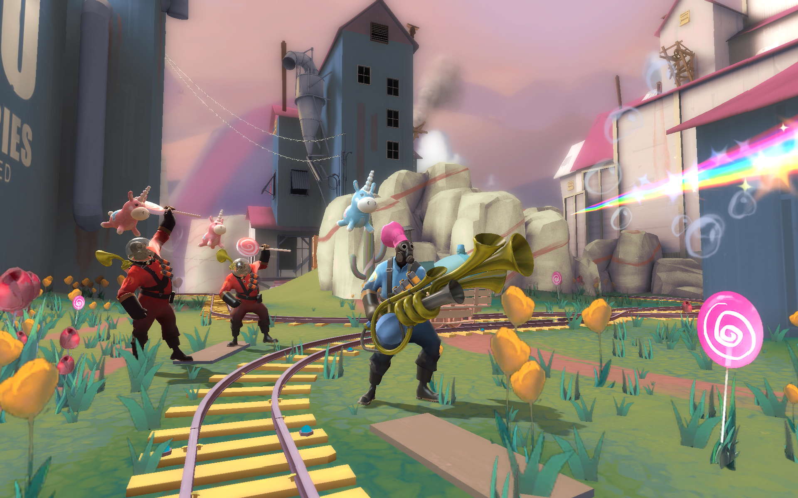
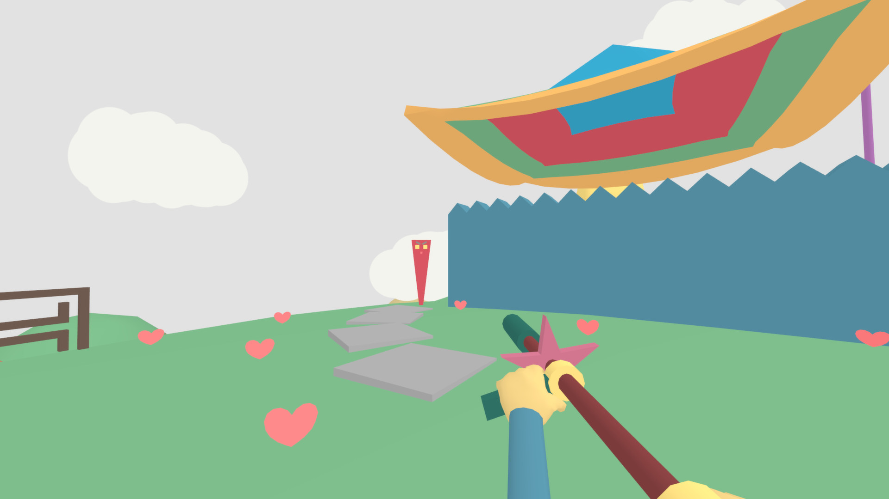

# Ideias, referencias e conceitos

* Jumping flash ( 2 e 3 )
    * aspecto de plataforma
* Quake
  * Arena multiplayer
* Toree3d
  * gráficos 
* [Lovely Planet](https://store.steampowered.com/app/1019590/Lovely_Planet_2_April_Skies/#app_reviews_hash)
* Exemplo de multiplayer estilo quake , de empresa indie [ScreenCheat](https://store.steampowered.com/app/301970/Screencheat/)
    

## Proposta:
Jogadores se conectarão em um lobby e jogarão diferentes modos de jogo.
* mata-mata ( primeiro time a marcar X pontos vence)
* Capture a bandeira ( marcar pontos )
* King of the hill ( ficar em cima de um ponto)
* Capture the point ( tf2, capturar e marcar pontos)
* *coop : matar um boss ou waves de inimigos guiados por IA no mapa* ( extra )

Jogo terá uma estética low poly "fofinha" (lovely planet), duas ou três armas diferentes para escolher (rifle/sniper/canhão), mas sem parecer muito armas de verdade ( estética fantástica, pyrovision)

### Mecânicas
* Andar (WASD) , correr (shift), pular (spacebar)
* Atirar
* Especial ( botão direito ) depende da arma selecionada OU levanta um escudo que absorve um tiro
